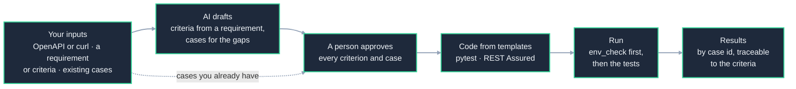

# api-qa-agent

[](https://github.com/rahulsharma-qe/api-qa-agent/actions/workflows/ci.yml)

**AI drafts, humans approve.** api-qa-agent turns what a team already has about its API (an
OpenAPI description or a curl with a sample response, the acceptance criteria of a change, and the
test cases it already wrote) into runnable API tests in the team's own framework: Python with
pytest, or Java with REST Assured and TestNG. The AI drafts cases and data; a reviewer approves every
one; templates write the code. Regression runs need no AI and no API key.

It is the "AI for quality" side of my work. Its sibling,
[`ai-quality-lab`](https://github.com/rahulsharma-qe/ai-quality-lab), is the "quality of AI" side:
testing AI agents themselves.

## How it works



Cases a team already has skip the drafting and go straight to review. The AI layer runs today with
recorded replies; replies from a real model, measured, are next.

## Try it (no API key)

```bash
git clone https://github.com/rahulsharma-qe/api-qa-agent.git && cd api-qa-agent
pip install -e . -e frameworks/python_api
cd examples/from-a-requirement && ./run_all.sh     # a ticket in plain words -> reviewed cases -> tests that pass
```

[Getting started](docs/getting-started.md) has the frameworks on their own, the example team project
in both frameworks, a new project of your own, and the Docker image.

## Where it stands

| | Status |
|---|---|
| Reference API ([`demo_api/`](demo_api/)) and environment check ([`env_check/`](env_check/)) | **Built** |
| Python framework ([`frameworks/python_api/`](frameworks/python_api/)): environments, OAuth, chaining, data-driven, Allure, evidence, retry | **Built** |
| REST Assured framework with TestNG ([`frameworks/restassured_api/`](frameworks/restassured_api/)): the same, in Java | **Built** |
| `qa-agent`: import the API and existing cases, check, review in Excel, generate, trace | **Built** |
| `qa-agent` every day: drift check, coverage floor, promote to regression, impact analysis | **Built** |
| Bug-detection rate: seven seeded bugs, which ones the tests catch | **Built** |
| Many teams ([`teams/`](teams/)); external APIs ([`examples/external-apis/`](examples/external-apis/)), where it found a real gap: Petstore accepts a pet with no name | **Built** |
| A Docker image of qa-agent ([`ghcr.io/rahulsharma-qe/qa-agent`](https://github.com/rahulsharma-qe/api-qa-agent/pkgs/container/qa-agent)), for a team with no Python install | **Built** |
| The AI layer: criteria from a requirement, cases for the gaps, every draft checked by code and approved by a person | **Built**, with recorded replies; **next**: a real model, measured |
| The model in your own cloud (AWS Bedrock, Google Vertex, Azure) | **Next** |
| Cucumber on REST Assured; Jira and wiki; results to TestRail, Zephyr or Xray | Later |
| User-interface tests, in their own repository (`playwright-qa-agent`) | Later |

Everything that needs no AI comes first, so a team can use it end to end with its existing cases
before any AI is switched on.

## Docs

| | |
|---|---|
| [Getting started](docs/getting-started.md) | Install, the examples, a project of your own, Docker |
| [Using qa-agent](docs/guide.md) | Every command, the day-to-day flow, the AI layer, suites, regression, Docker, CI |
| [Architecture](docs/architecture.md) · [Design](docs/lld.md) | High-level and low-level design, as built |
| [The first version](docs/history/first-version.md) | Where this started: one requirement, two models, five frameworks |

## What's inside

| Folder | What it is |
|---|---|
| [`demo_api/`](demo_api/) | The reference API: bookings, cancel with a 24-hour refund rule, refund status, tokens, health checks, seeded bugs |
| [`env_check/`](env_check/) | Before a run: every service a team depends on; exit 3 when a critical one is down |
| [`frameworks/`](frameworks/) | The Python (pytest) and Java (REST Assured, TestNG) frameworks, each a library on its own with an example per feature |
| [`qa_agent/`](qa_agent/) | `qa-agent`, the command line: `init`, `import`, `check`, `review`, `generate`, `trace`, `promote`, `suite`, `impact-analysis`, `bug-detection`, `draft` |
| [`examples/`](examples/) | [`bookings-team`](examples/bookings-team/) (every feature, with its output), [`from-a-requirement`](examples/from-a-requirement/) (the AI layer), [`external-apis`](examples/external-apis/) (Swagger Petstore) |
| [`teams/`](teams/) | Two small teams, each shaped like its own repository, using the reusable CI workflow |
| [`docs/`](docs/) | Getting started, the guide, the design |

## Design choices

- **AI drafts, humans approve.** Nothing the AI writes becomes a test until a person approves it,
  and the rules that guard it are in code, not in the prompt.
- **Tests are data; templates write the code.** The code always runs, the same case runs in every
  framework, and a person who doesn't write code can review a case.
- **Existing cases first.** A team brings what it has; the AI drafts only what no case covers.
- **Regression needs no AI.** Generated code is committed; it runs on every build without a model.
- **Careful with data.** What is sent to a model is redacted and every call is logged; running the
  model in the organisation's own cloud is next.
- **An environment problem is not a bug.** env_check stops a run with its own exit code.
- **Many teams.** Frameworks are versioned libraries; each team works in its own repository and
  builds only its own framework.

Released under the [MIT License](LICENSE).
