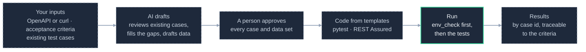

# api-qa-agent

[](https://github.com/rahulsharma-qe/api-qa-agent/actions/workflows/ci.yml)

**AI drafts, humans approve.** api-qa-agent turns what a team already has about its API (an
OpenAPI description or a curl with a sample response, the acceptance criteria of a change, and the
test cases it already wrote) into runnable API tests in the team's own framework: Python with
pytest, or Java with REST Assured and TestNG. The AI drafts cases and data; a reviewer approves every
one; templates write the code. Regression runs need no AI and no API key.

It is the "AI for quality" side of my work. Its sibling,
[`ai-quality-lab`](https://github.com/rahulsharma-qe/ai-quality-lab), is the "quality of AI" side:
testing AI agents themselves.

## Where it stands

| | Status |
|---|---|
| Reference API to test against ([`mock_service/`](mock_service/)) | **Built**: bookings, tokens, cancel and refund rules, health checks; its OpenAPI description is checked in CI |
| Environment check ([`env_check/`](env_check/)) | **Built**: a dependency that is down stops the run as an environment problem, never a test failure |
| Python framework ([`frameworks/python_api/`](frameworks/python_api/)) | **Built**: environments, OAuth, API chaining, data-driven tests, readable failures, JUnit reports |
| Python framework for QA teams: Allure report, smoke and priority tags, evidence, retry | **Built** (phase 1b) |
| REST Assured framework with TestNG ([`frameworks/restassured_api/`](frameworks/restassured_api/)) | **Built** (phase 2): the same features in Java, with TestNG groups and suites, Excel-driven data, Allure, evidence, retry |
| `qa-agent`: the case format, API import (OpenAPI, curl), `check` ([`qa_agent/`](qa_agent/), [example](examples/bookings-team/)) | **Built** (phase 3a, part 1): cases as data, one file per feature; every case checked against the API and the criteria, with the fix |
| Importers of existing cases (Excel, CSV, Postman, Gherkin), the Excel review sheet | Phase 3a, part 2 |
| Generated tests (pytest, REST Assured), traceability, `qa-agent init` | Phase 3a, part 3 |
| Drift check, promote, bug-detection rate, two example teams | Phase 3b |
| Cucumber on REST Assured | Phase 3c |
| User-interface tests | Phase 4, in its own repository (`playwright-qa-agent`) |
| Jira and wiki; results back to TestRail, Zephyr or Xray | Phase 5 |
| The AI layer: drafting, review, the model in your own cloud | Phase 6 |

Everything that needs no AI comes first, so a team can use the utility end to end with its
existing test cases before any AI is switched on.

## How it works



Green border: built. Dashed: designed, coming in the phases above.

## Try it (no API key)

```bash
pip install -e . -e frameworks/python_api          # the reference API, env_check, qa-agent, the Python framework
python -m mock_service &                           # bookings on :8000, notifications on :8001
cd frameworks/python_api
python -m env_check --env mock                     # is the environment ready?
pytest                                             # every example, against the reference API
```

The same examples in Java (Java 17; Maven comes with the wrapper):

```bash
cd frameworks/restassured_api
./mvnw test                                        # with the reference API running, as above
```

When a test fails, the report shows the expectation that broke and every request and response of
the test, in order, with tokens masked. See each framework's README:
[Python](frameworks/python_api/README.md) and [REST Assured](frameworks/restassured_api/README.md).

And `qa-agent` on a team's project (no service needed):

```bash
cd examples/bookings-team
qa-agent check                                     # every case, against the API and the criteria
```

What `check` finds there, and why, is in the [example's README](examples/bookings-team/README.md).

## What's inside

| Folder | What it is |
|---|---|
| [`mock_service/`](mock_service/) | The reference API: bookings (create, read, update, delete, list), cancel with a 24-hour refund rule, refund status, tokens, health checks, and a stand-in dependency that can be switched down |
| [`env_check/`](env_check/) | Before a run: call every service a team depends on; exit 3 when a critical one is down. One tool for every framework |
| [`frameworks/python_api/`](frameworks/python_api/) | The Python framework (pytest, httpx), installable on its own, with an example for every feature |
| [`frameworks/restassured_api/`](frameworks/restassured_api/) | The Java framework (REST Assured, TestNG), a Maven library on its own, with an example for every feature |
| [`qa_agent/`](qa_agent/) | `qa-agent`, the command line: the case format, importers, `check` |
| [`examples/bookings-team/`](examples/bookings-team/) | A team's project for the reference API: every `qa-agent` feature, with its output |
| [`docs/`](docs/) | The design: [high-level](docs/architecture.md) and [low-level](docs/lld.md) |
| `core/` | The first version's language-model steps (case and data drafting, a review step); reworked into the AI layer in phase 6 |

## Design choices

- **AI drafts, humans approve.** Nothing the AI writes becomes a test until a person approves it.
- **Tests are data; templates write the code.** The code always runs, the same case runs in every
  framework, and a person who doesn't write code can review a case.
- **Existing cases first.** The AI reviews what the team already has and drafts only what is missing.
- **Regression needs no AI.** Generated code is committed; it runs on every build without a model.
- **Safe for regulated organisations.** Only the API's structure is sent to a model, after
  redaction; the model can run in the organisation's own cloud (AWS Bedrock, Google Vertex, Azure);
  every call is logged.
- **An environment problem is not a bug.** env_check stops a run with its own exit code.
- **Many teams.** Frameworks are versioned libraries; each team works in its own repository and
  builds only its own stack.

## The first version

This repository started as a smaller pipeline: a language model turned one requirement into test
cases and data, a second model reviewed them, and the package was rendered into five test stacks,
one of which ran. Its design is kept in [`docs/history/first-version.md`](docs/history/first-version.md),
and its code in the git history.

Released under the [MIT License](LICENSE).
