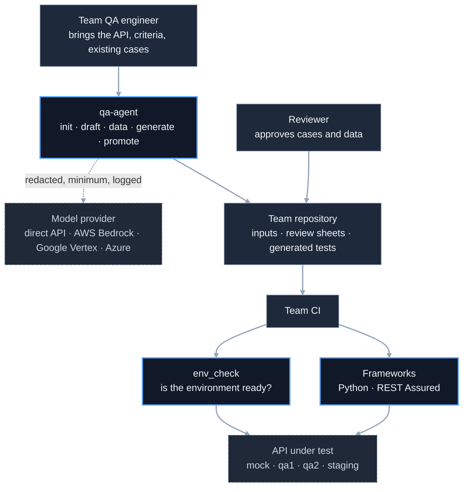
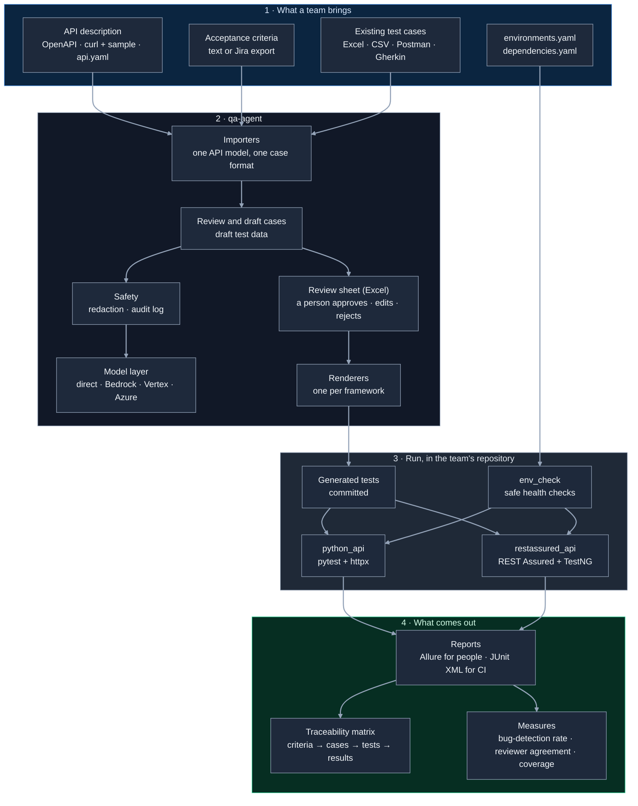
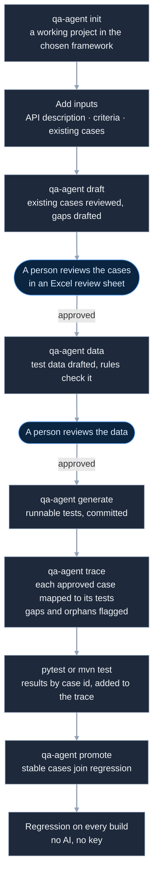
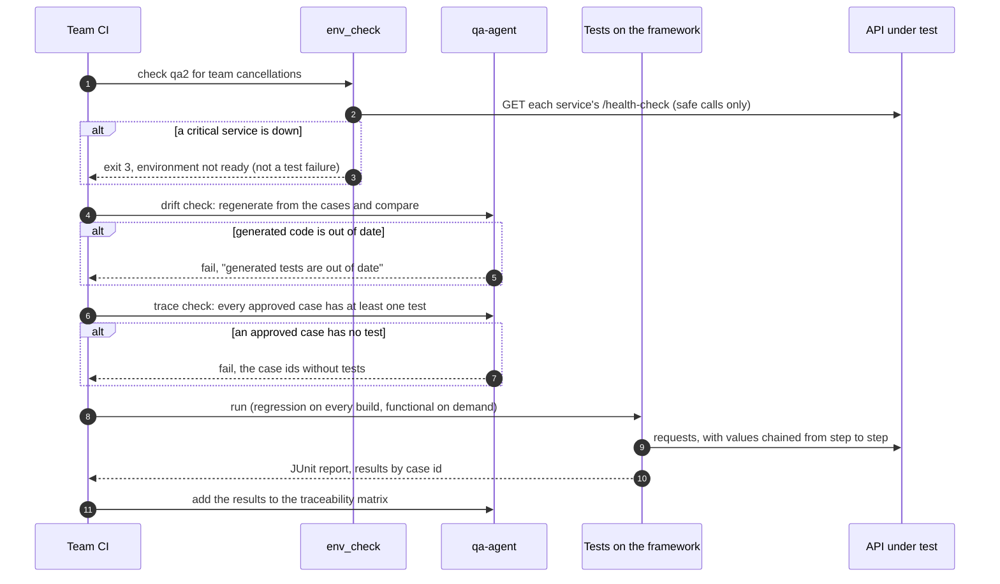
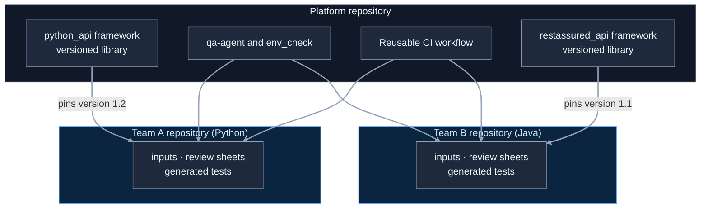

# api-qa-agent: high-level design

**AI drafts, humans approve.** The utility turns what a team already has about its API (a description
of the API, the acceptance criteria of a change, and the test cases it already wrote) into runnable API
tests in the team's own framework, Python or REST Assured. Regression runs need no AI.

Status: **design**. Each phase below is built and checked before the next one starts.

The command-line tool is `qa-agent`. Its core (case format, importers of existing cases, review
files, traceability, safety, the model layer) is a package other agents reuse: the user-interface
agent, `playwright-qa-agent`, is a separate repository that depends on it.

## 1. Goals and non-goals

**Goals**

1. **A team gets runnable tests on day one.** One command creates a working test project in the
   team's chosen framework (Python or REST Assured), already wired into continuous integration (CI).
2. **No test code by hand.** The AI drafts test cases and test data as structured data; templates
   turn approved cases into code. The code always runs, and the same case runs in every framework.
3. **People decide.** Existing test cases come first; the AI reviews them and drafts only what is
   missing; a person approves cases and data in a review file before anything becomes a test.
4. **Two tracks.** New work is *functional*; a case that passes and stays stable is promoted to
   *regression*, which runs on every build with no AI and no API key.
5. **Many teams, many stacks, many environments.** Each team works in its own repository and builds
   only its own stack; any number of environments and services per team.
6. **Safe for regulated organisations.** Only the API's structure is sent to a model, after
   redaction; the model can run inside the organisation's own cloud; every call is logged.
7. **The AI's work is measured.** The bug-detection rate of the generated suite (seeded bugs caught), agreement of the AI
   reviewer with people, and coverage of the API's endpoints.
8. **Everything traces.** Each acceptance criterion maps to its approved cases, each case to the
   tests generated from it (one or many), and each test to its latest result.

**Non-goals (for now)**

- User-interface tests in this repository: they belong to `playwright-qa-agent` (phase 4,
  section 12). Performance tests are out of scope.
- A model writing whole test files: code comes from templates (a model writes only small,
  gated custom checks, section 11).
- A hosted service: the platform is a command-line tool, libraries and a CI workflow.
- Publishing the frameworks to public package registries. Until the Jira and wiki connection
  (section 12), acceptance criteria come in as text or an export.

## 2. Who uses it, and what it talks to



Blue-bordered boxes are the platform; dashed boxes are outside the organisation's test code.

| Actor | What they do |
|---|---|
| Team QA engineer | Runs `qa-agent`, adds the team's inputs, runs the tests |
| Reviewer (a person on the team) | Approves, edits or rejects every drafted case and data set |
| Team CI | Checks the environment, checks generated code is up to date, runs the tests, keeps the report |
| Model provider | Drafts and reviews cases and data; chosen by the organisation |
| API under test | The team's services in each environment; a mock service for the examples |

## 3. Components



| Component | Responsibility | Knows about |
|---|---|---|
| Importers | Read OpenAPI, curl with a sample response, or `api.yaml` into one API model; read existing cases from Excel, CSV, a Postman collection or Gherkin into one case format | Input formats only |
| Review and draft | Convert and review existing cases, flag problems, list gaps against the API and the criteria, draft only the missing cases; draft test data | The case format, the model layer |
| Safety | Remove secrets and personal data before anything is sent; send only the endpoint being tested; log every call | Nothing else; every model call passes through it |
| Model layer | One interface; the provider is configuration | Provider software only |
| Review sheet | An Excel sheet (one row per case: steps, expected result, approve / edit / reject, comment), the format testers already use; only approved items move on. The case format underneath stays YAML | The case format |
| Renderers | Turn approved cases into code for one framework, the same way every time | One framework's style each |
| Frameworks | Libraries a team's tests run on: configuration, client, expectations, chaining, test data, tags | Nothing about qa-agent |
| env_check | Before a run, call each service's health endpoint; stop with a clear message if a critical one is down | `environments.yaml`, `dependencies.yaml` |
| Promote | Move a case to regression once it passed and stayed stable | Run results |
| Mock service | A reference API (bookings) the examples and CI run against | Nothing else |

## 4. A team's journey



- A team without existing cases skips nothing: the import step is simply empty and the AI drafts
  the whole set.
- Before the AI layer (phase 6), `draft` imports and checks the team's existing cases with rules
  only, and a person writes or edits cases in the review file; everything after it works the same.
- A rejected case or data set goes back with the reviewer's note; nothing unapproved becomes code.
- A test case is data (steps, request, expected result, values captured for the next step), so a
  person who does not write code can review it:

```yaml
id: TC003
title: Cancel exactly at 24 hours gets a full refund
criteria: [AC-2]          # the acceptance criterion it proves
track: functional
steps:
  - request: {method: POST, path: /bookings,
              body: {passenger: Asha Rao, amount: 250, booked_at: "2026-10-20T10:00:00Z"}}
    expect: {status: 201}
    capture: {pnr: pnr}
  - request: {method: POST, path: "/bookings/{{pnr}}/cancel",
              body: {cancelled_at: "2026-10-21T10:00:00Z"}}
    expect: {status: 200, fields: {refund_allowed: true, refund_amount: 250}}
```

## 5. One CI run, step by step



## 6. Many teams: the platform and the teams are separate



- **A team builds only its own stack.** A Python team never installs Java; a Java team never
  installs the Python framework.
- **Teams don't affect each other:** separate repositories, separate CI, separate results.
- **Frameworks are versioned.** A team pins a version and upgrades when it chooses.
- **Generated code is committed in the team's repository,** so regression runs without AI, and a
  drift check keeps it in step with the approved cases.
- **Organisation defaults, team overrides that can only tighten them** (for example, an
  environment marked read-only stays read-only).
- **One line joins a team's CI:** the reusable workflow, with the stack and the environment as
  inputs. Teams on Jenkins or GitLab follow the same four steps from the guide.
- In this repository, `teams/<team>/` folders play the team repositories: each has exactly the
  shape of a standalone team repository.

## 7. Where it runs

| Place | What runs there | Model access needed |
|---|---|---|
| A tester's machine | `init`, `generate`, `promote`, the tests, `env_check` | No |
| A tester's machine | `draft`, `data` | Yes, through the organisation's chosen provider |
| CI, on every change | `env_check`, drift check, regression tests, reports | No |
| CI, on demand | Functional tests; the run against a public API (Swagger Petstore) as proof on someone else's API | No |

## 8. Safety and compliance

| Rule | How |
|---|---|
| Only structure is sent | Endpoint, fields, acceptance criteria and case text; never production data or real customer data; test data is synthetic |
| Redaction first | Tokens (curl often carries `Authorization` headers), internal host names, emails, phone and card numbers are removed before a call |
| Minimum sent | Only the endpoint being tested, not the whole API description |
| The organisation chooses where the model runs | Direct API, AWS Bedrock, Google Vertex or Azure, by configuration; supported in code and tested with fakes, confirmed live on the organisation's own account |
| Every call is logged | What was sent (after redaction), to which provider and model, and when |
| A path with no AI | Import existing cases, review, generate and run without any model; regression never calls a model |

## 9. Quality attributes, and how the design meets them

| Attribute | How |
|---|---|
| Simple | Each framework has one place per concern (configuration, client, expectations, context, data); tests hold no logic |
| Extendable | A new framework is a folder and a renderer; a new input format is an importer; nothing else changes |
| Repeatable | Templates give the same code for the same case; regression has no AI |
| Scales to many teams | Platform and teams separate; versioned frameworks; one CI line per team |
| Safe | Section 8 |
| Honest results | An environment problem (exit 3) is never reported as a product bug; a failed test shows the request, the response and the expectation that broke; a test that passes only on retry is reported as such, never as a plain pass |
| Evidence | Every test's requests and responses, pass or fail, are kept in the Allure report and, on request, in an evidence folder for audits and sign-off |
| Measured | Bug-detection rate, reviewer agreement and endpoint coverage, section 10 |
| Traceable | Criteria → cases → tests → results in one matrix; CI fails if an approved case has no test |

## 10. Measuring the AI's work

| Measure | Question it answers | How |
|---|---|---|
| Bug-detection rate (mutation testing) | Do the generated tests catch bugs, not just pass? | The mock service can switch on small planted bugs (a boundary moved, a deleted booking still returned); the share the suite catches |
| Reviewer agreement | Can we trust the AI reviewer's comments? | Its comments against the reviewer's decisions in the review sheets; tuning and held-back halves, as in the sibling repository |
| Endpoint coverage | Is every endpoint and response code tested? | Approved cases against the API description (API → cases) |
| Criteria coverage | Is every acceptance criterion tested? | Each criterion's approved cases (criteria → cases) |
| Case-to-test mapping | Did every approved case become a test? | One case to one test, or one to many (a data-driven case runs once per data row; the same case in two frameworks); flags a case with no test and a test with no case (cases → tests) |
| Stability | Is a case ready for regression? | Passed, and the same result in three runs |

## 11. Key decisions and their trade-offs

| Decision | Why | What it costs |
|---|---|---|
| Tests are data; templates write the code | Code always runs; one case, every framework; a non-coder can review | Unusual logic needs a custom check (below) |
| A model may write a small custom check | Covers logic the case format can't express | Each one passes a compile, a run and a person before use |
| Existing cases first, the AI fills gaps | Keeps the team's work; less for the AI to get wrong; one review | An importer per case format |
| Review in an Excel sheet | Testers and analysts already work in sheets; a record of who approved what; CI can check it | An importer and exporter for the sheet |
| Allure for people, JUnit XML for CI | One readable report (steps, requests, responses, history) in both frameworks; CI still reads JUnit | Allure's command-line tool to build the HTML |
| Retry once, shown separately | Flaky tests don't block a build, and a retry never hides a failure | A second run on failure |
| TestNG with REST Assured | The stack most QA teams already run: groups, `testng.xml` suites, data providers, listeners | Not the default in developer teams (JUnit 5) |
| Frameworks as libraries; teams in their own repositories | Teams independent; each builds one stack | Versions to publish and maintain |
| env_check as a separate tool | One tool for every framework; can become its own service later | Another small tool to keep |
| Cucumber on top of REST Assured | One Java client, not two; the plain-English feature files analysts read | Cucumber waits for REST Assured (phase 3c) |
| `setup-python` in CI before a Docker image | Less to build and keep now | A Java team needs Python to run `qa-agent` until the image exists |

## 12. Phases

Everything that needs no model comes first, so a team can use the utility end to end with its
existing cases before any AI is switched on. The AI layer comes last and sits on top.

| Phase | What | Model access |
|---|---|---|
| 0 | Mock bookings service (create, read, update, delete, cancel, token, refund status, health check; `booked_at` and `cancelled_at` so time boundaries can be tested), a stand-in notifications service that can be switched down, the OpenAPI description; repository clean-up | No |
| 1 | Python framework and env_check, with an example for every feature | No |
| 1b | Python framework, for QA teams: Allure report, `smoke` and `priority` tags, evidence of every test, one retry shown separately | No |
| 2 | REST Assured framework with TestNG: the familiar layout (`BaseTest`, request specifications, listeners, `testng.xml` suites for smoke, regression and functional, Excel data), Allure, evidence, retry, the Maven wrapper; same environments file | No |
| 3a | Case format, importers (API descriptions; existing cases from Excel, CSV, Postman collections, Gherkin), the Excel review sheet, renderers, `generate`, `trace`, `init` | No |
| 3b | Drift check, `promote`, bug-detection rate, two example teams, the reusable workflow, the public-API run, a one-command setup (Docker image for qa-agent) | No |
| 3c | Cucumber on REST Assured: step definitions written once, `.feature` files generated from the same cases | No |
| 4 | User-interface track, in its own repository `playwright-qa-agent` (TypeScript, Playwright Test), using this repository's core as a package: the team's UI cases imported, reviewed, generated and run through the same flow; rule-based self-healing (each element has ranked locators: test id, then role and name, then text), every heal logged and approved by a person before it is kept; a small bookings web page on the mock service, with a switch that renames elements to show healing | No |
| 5 | Jira and wiki: read acceptance criteria from a Jira issue or a wiki page; a failing test goes to a triage file, and a person decides before a Jira bug is raised with the request, response and case attached; results sent back to TestRail, Zephyr or Xray by case id; tested with fakes, confirmed live on a free Atlassian account | No (needs Jira and wiki access) |
| 6 | The AI layer: AI review of existing cases, drafting of missing cases and test data (API and UI), a suggested locator when rule-based healing fails, a suggested triage; model providers (direct API, AWS Bedrock, Google Vertex, Azure); safety (redaction, minimum sent, audit log); reviewer agreement | Yes |

## 13. Limits, and what comes later

- **Later frameworks:** Apache HttpClient with TestNG. Cucumber is phase 3c; Playwright is phase 4,
  in its own repository.
- **MCP:** in `playwright-qa-agent`, the Playwright MCP server lets the AI layer explore a page to
  draft UI cases and suggest locators; a QA MCP server could offer `qa-agent`'s commands to any AI
  assistant. Both are discussed when the AI layer starts.
- **The core in its own repository,** when a third agent needs it.
- **A full health-check framework** as its own repository: history, schedules, alerts and
  environment booking, when several repositories need it.
- Publishing the frameworks to package registries, when a team outside this repository uses them.
- Parallel runs; a dashboard of every team's results.
