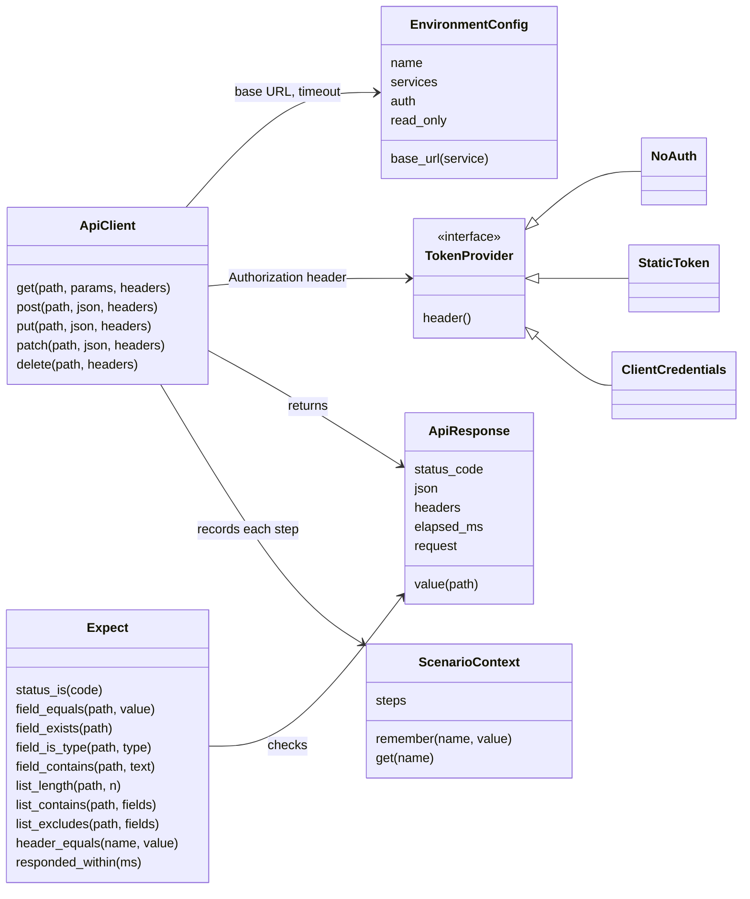

# api-qa-agent: low-level design

The high-level design ([architecture.md](architecture.md)) says what the utility is and why. This
document says how each part is built. It grows phase by phase: this version covers **phase 0**
(the mock service), **phase 1** (the Python framework and env_check), **phase 1b** (the Python
framework for QA teams), **phase 2** (the REST Assured framework with TestNG), **phase 3a**
(cases, importers, the review sheet, generated tests, trace and init) and **phase 3b** (drift check,
promote, bug-detection rate, teams, Petstore, Docker); later phases get their sections when they are
designed.

## 1. Repository layout after phase 2

```
api-qa-agent/
  README.md  LICENSE  pyproject.toml     pip install -e .  installs mock_service and env_check
  mock_service/                  the reference API under test (FastAPI)
    __main__.py                  python -m mock_service  -> bookings on :8000, notifications on :8001
    bookings_app.py              create_bookings_app(): routes for auth, bookings, refunds, health
    notifications_app.py         create_notifications_app(): a stand-in dependency that can be switched down
    booking_store.py             BookingStore: in-memory bookings, reset for tests
    refund_rules.py              decide_refund(booking, cancelled_at): the 24-hour rule, in one place
    models.py                    request and response shapes (pydantic)
    errors.py                    one error shape for every failure
    openapi.json                 the OpenAPI description, exported from the app and committed
  env_check/                     is the environment ready? (one tool for every framework)
    __main__.py                  python -m env_check --env qa2 --dependencies teams/x/dependencies.yaml
    readiness.py                 check_environment() -> ReadinessReport
    settings.py                  reads environments.yaml and dependencies.yaml
  frameworks/
    python_api/                  installable on its own: pip install ./frameworks/python_api
      pyproject.toml
      api_test_framework/
        environment.py           EnvironmentConfig, load_environment()
        auth.py                  NoAuth, StaticToken, ClientCredentials
        api_client.py            ApiClient: get / post / put / patch / delete -> ApiResponse
        api_response.py          ApiResponse: status, json, headers, elapsed, value("a.b[0].c")
        expect.py                Expect(response).status_is(201).field_equals("status", "active") ...
        scenario_context.py      ScenarioContext: values carried between steps, and the step history
        test_data.py             load_rows() from JSON, CSV or Excel; new_passenger()
        pytest_plugin.py         fixtures, --env, markers, the chain shown on failure
      config/environments.yaml   mock, qa1, qa2, staging
      data/cancellation_boundaries.csv
      tests/examples/            one runnable example per feature, shaped like generated tests
      tests/unit/                the framework's own tests (no network)
    restassured_api/             the same framework in Java (REST Assured, TestNG): section 5
  tests/mock_service/            the mock service's own tests
  tests/env_check/               env_check's own tests (a fake network)
  docs/  architecture.md  lld.md  history/first-version.md
  .github/workflows/ci.yml
```

**Rules**
- `frameworks/python_api` never imports `mock_service`: expected values come from the test or
  its data, never from the service's code. A unit test fails the build if such an import appears.
- `env_check` and the framework read the same `environments.yaml` format. env_check reads only the
  service addresses, so it needs nothing from the framework (a Java team uses it too).
- Every folder has a README with how to run it in three commands or fewer.
- Tests make their own data and check their own items, never totals: they pass in any order and on
  an environment other teams are using.


## 2. Mock service (phase 0)

### 2.1 Endpoints

All `/bookings` endpoints need `Authorization: Bearer <token>`; without it, or with a wrong
token: **401**.

| Method and path | Request | Success | Other responses |
|---|---|---|---|
| `POST /auth/token` | `{client_id, client_secret}` | 200 `{access_token, token_type: "Bearer", expires_in: 3600}` | 401 wrong credentials |
| `POST /bookings` | `{passenger_name, email, amount, booked_at?}` | 201 the booking | 422 invalid field |
| `GET /bookings/{pnr}` | | 200 the booking | 404 |
| `GET /bookings?status=active&limit=20` | | 200 `{items: [...], count}` | 422 bad filter |
| `PUT /bookings/{pnr}` | `{passenger_name, email}` | 200 the booking | 404; 422 invalid, or `amount` sent (it can't change) |
| `DELETE /bookings/{pnr}` | | 204 | 404 |
| `POST /bookings/{pnr}/cancel` | `{cancelled_at?}` | 200 `{pnr, refund_allowed, refund_amount, reason}` | 404; 409 already cancelled; 422 cancelled before booked |
| `GET /bookings/{pnr}/refund` | | 200 `{pnr, refund_status: "refunded" \| "no_refund" \| "not_cancelled", refund_amount}` | 404 |
| `GET /health-check` | no token needed | 200 `{status: "ok", service: "bookings"}` | |
| `POST /test/reset` | no token needed | 204, every booking removed | 404 when test mode is off |

**Notifications stand-in (port 8001):** `GET /health-check` returns 200, or 503 while it is
switched down (`POST /test/state {"down": true}` or `NOTIFICATIONS_DOWN=1`). Bookings never call
it; it exists so env_check has a non-critical dependency to report on.

### 2.2 The booking

| Field | Rule |
|---|---|
| `pnr` | 6 upper-case letters and digits, made by the service, unique |
| `passenger_name` | 1 to 100 characters |
| `email` | a valid address |
| `amount` | a number, 0 or more; fixed after creation |
| `status` | `active` or `cancelled` |
| `booked_at` | ISO 8601 with a time zone; the caller may set it (so time boundaries can be tested), otherwise now |
| `cancelled_at` | empty until cancelled |

### 2.3 The refund rule (`refund_rules.decide_refund`)

| Hours from `booked_at` to `cancelled_at` | Result |
|---|---|
| less than 0 | 422: cancelled before it was booked |
| 0 to 24, **24 included** | refund allowed, full amount |
| more than 24 | no refund, amount 0 |

`cancelled_at` defaults to now. A second cancel returns 409 and changes nothing.

### 2.4 Errors, configuration, OpenAPI

- **One error shape** for every failure, including validation:
  `{"error": {"code": "booking_not_found", "message": "No booking with PNR AB12CD"}}`.
- **Configuration by environment variables:** `MOCK_CLIENT_ID` and `MOCK_CLIENT_SECRET`
  (defaults `demo-client` and `demo-secret`), `MOCK_TEST_MODE` (default on; turns `/test/*` on).
- **OpenAPI:** `python -m mock_service --export-openapi mock_service/openapi.json`. A test fails if the
  committed file differs from what the app produces, so the description never drifts.

## 3. env_check (phase 1)

### 3.1 Files

```yaml
# environments.yaml (shared with the framework)
environments:
  mock:
    services: {bookings: "http://localhost:8000", notifications: "http://localhost:8001"}
    auth: {type: client_credentials, service: bookings, token_path: /auth/token,
           client_id: demo-client, client_secret: demo-secret}   # plain values: mock only
    timeout_seconds: 10
    read_only: false
  qa1:
    services: {bookings: "https://qa1.example/bookings", notifications: "https://qa1.example/notify"}
    auth: {type: client_credentials, service: bookings, token_path: /auth/token,
           client_id_env: QA1_CLIENT_ID, client_secret_env: QA1_CLIENT_SECRET}
    read_only: false
  staging:
    services: {bookings: "https://staging.example/bookings"}
    auth: {type: static_token, token_env: STAGING_TOKEN}
    read_only: true
```

```yaml
# dependencies.yaml (one per team)
team: cancellations
checks:
  - service: bookings                 # host from environments.yaml
    critical: true
  - service: notifications
    path: /health-check               # default; set it when a service uses another path
    critical: false
```

Per check, with defaults: `path: /health-check`, `expect_status: 200`, `timeout_seconds: 5`,
`critical: true`. Per file: `attempts: 3`, `wait_seconds: 2` (doubled after each failed attempt).

### 3.2 Behaviour

1. Read both files; a missing service, a bad field or an unknown environment is a setup error.
2. For each check, `GET` (only `GET`) the service's path; retry a failed attempt after the wait.
3. Print one line per check (service, status, time, ok / DOWN) and a verdict.

| Exit code | Meaning |
|---|---|
| 0 | Ready (a non-critical service may be down; it is listed) |
| 2 | Setup problem: a file or setting is wrong |
| 3 | Not ready: a critical service is down. Not a test failure |

`--environments` and `--dependencies` default to `config/environments.yaml` and
`config/dependencies.yaml`. `--json` prints the same report as JSON for CI pages. From Python: `check_environment(name,
environments_path, dependencies_path) -> ReadinessReport`.

## 4. Python framework (phase 1)

### 4.1 Classes



| Class | Responsibility | Notes |
|---|---|---|
| `EnvironmentConfig` | One environment from `environments.yaml` | Chosen by `--env` or `API_ENV` (default `mock`) |
| `TokenProvider` | The `Authorization` header | `NoAuth`; `StaticToken` from an environment variable; `ClientCredentials` asks the token endpoint once per run and reuses it |
| `ApiClient` | One service's HTTP calls | Base URL from the environment; timeout; records every request and response in the scenario context; the token is masked in every log; `without_auth()` gives the same client with no token, for 401 tests |
| `ApiResponse` | What came back | `value("items[0].pnr")` reads any field by a dotted path; a missing field fails with the path and the body |
| `Expect` | Checks, chained | Each failure says what was expected, what came back, and the request that produced it. `list_contains` and `list_excludes` find the test's own items in a list, so a test never depends on totals |
| `ScenarioContext` | Values carried between steps, and the steps so far | Fresh for every test |

### 4.2 pytest plugin

| Gives | How |
|---|---|
| `--env qa2` | Same as `API_ENV=qa2` |
| Fixtures | `environment`; `api` (client for the default service); `api_for("notifications")`; `context` |
| Markers | `smoke`, `regression`, `functional`, `writes` (changes data: skipped on a `read_only` environment, with the reason in the report), `case("TC003")` (the case id, written into the JUnit report for traceability), `priority("P0")` (P0 to P3; phase 1b) |
| On failure | The whole chain: every step's request and response, then the expectation that broke |
| Report | `pytest --junitxml=reports/junit.xml` for CI; Allure for people (phase 1b, section 4.5) |

### 4.3 A test written with it

```python
@pytest.mark.functional
@pytest.mark.writes
@pytest.mark.case("TC003")
def test_cancel_exactly_at_24_hours_gets_a_full_refund(api, context):
    created = api.post("/bookings", json={**new_passenger(), "amount": 250,
                                           "booked_at": "2026-10-20T10:00:00Z"})
    Expect(created).status_is(201)
    context.remember("pnr", created.value("pnr"))

    cancelled = api.post(f"/bookings/{context.get('pnr')}/cancel",
                         json={"cancelled_at": "2026-10-21T10:00:00Z"})
    Expect(cancelled).status_is(200).field_equals("refund_allowed", True).field_equals("refund_amount", 250)
```

This is the shape `qa-agent generate` will write in phase 3: no logic, only steps and checks.

### 4.4 Examples (one per feature)

| Example | Shows |
|---|---|
| `test_get_booking.py` | GET: 200, 404, and 401 without a token |
| `test_booking_lifecycle.py` | Create → read → update → read → delete → read gives 404, the PNR carried between steps |
| `test_auth_chain.py` | Token → create → cancel → refund status, across three endpoints |
| `test_cancel_boundaries.py` | Data-driven from `data/cancellation_boundaries.csv`: 23:59, exactly 24:00, 24:01, cancelled before booked, already cancelled |
| `test_list_and_filters.py` | List with a filter: the test's own items found or absent; limit; a bad filter |
| `test_other_services.py` | `api_for("notifications")`: another service in the same environment |
| Environments | README: the same tests with `--env qa1`; a `writes` test skipped on a `read_only` environment |
| env_check | README: ready, then the notifications stand-in switched down (warned, still ready), then bookings stopped (exit 3) |

### 4.5 Phase 1b: what QA teams expect

| Feature | How | Notes |
|---|---|---|
| Allure report | `allure-pytest`; `pytest --alluredir=reports/allure-results`, then `allure generate` | Every step's request and response is attached (token masked); `case` becomes a label, `priority` the severity (P0 blocker, P1 critical, P2 normal, P3 minor), markers become tags. CI builds the HTML and keeps it |
| Smoke and priority | `@pytest.mark.smoke`, `@pytest.mark.priority("P0")` | `pytest -m smoke`; priority is also written into the JUnit report |
| Evidence of every test | `pytest --evidence reports/evidence` | One text file per test, pass or fail: result, then every request and response in order, token masked. For audits and sign-off |
| One retry, shown separately | `pytest --reruns 1` (`pytest-rerunfailures`) | A test that fails and then passes is listed under "Passed on retry: look at these", marked in the JUnit report and in Allure; never shown as a plain pass. CI runs with one retry; a laptop run has none unless asked |

## 5. REST Assured framework (phase 2)

The same shape as the Python framework, in the layout Java QA teams already know. Tests read the
same `environments.yaml` and `dependencies.yaml` (env_check runs before Maven, as in Python).

### 5.1 Layout

```
frameworks/restassured_api/
  pom.xml  mvnw  mvnw.cmd  .mvn/wrapper/      the Maven wrapper: no Maven install needed
  config/environments.yaml  config/dependencies.yaml
  data/cancellation_boundaries.csv  data/cancellation_boundaries.xlsx
  suites/smoke.xml  suites/regression.xml  suites/functional.xml       testng.xml suites by group
  src/main/java/apiqa/framework/
    config/      EnvironmentConfig, EnvironmentLoader (SnakeYAML; -Denv=qa2 or API_ENV)
    auth/        TokenProvider: NoAuth, StaticToken, ClientCredentials
    client/      ApiClient (REST Assured, a RequestSpecification per service), ApiResponse (value("items[0].pnr"))
    expect/      Expect: statusIs, fieldEquals, fieldExists, fieldIsType, fieldContains, listLength,
                 listContains, listExcludes, headerEquals, respondedWithin
    context/     ScenarioContext: remember, get, steps
    data/        TestData: rows from CSV, Excel (Apache POI) or JSON (Jackson); NewPassenger
    testng/      BaseTest, CaseId (annotation), Priority (annotation), ApiStepsListener, RetryOnce
  src/test/java/apiqa/examples/      one test class per feature, as in Python
```

### 5.2 TestNG pieces

| Piece | Responsibility |
|---|---|
| `BaseTest` | Before each test: the environment, a fresh `ScenarioContext`, `api()` and `apiFor("notifications")`; skips a test in group `writes` on a `read_only` environment, with the reason |
| Groups | `smoke`, `regression`, `functional`, `writes`; `mvn test -Dgroups=regression`, or a suite file: `mvn test -Dsurefire.suiteXmlFiles=suites/regression.xml` |
| `@CaseId("TC003")`, `@Priority("P0")` | Written into the reports by the listener (Allure label and severity; a TestNG attribute) |
| `ApiStepsListener` | On failure: every step's request and response, in order, into the log and Allure. Every test, pass or fail: an evidence file when `-Devidence=reports/evidence` is set |
| `RetryOnce` | `-Dretry=1`: a failed test runs once more; a pass on retry is listed separately and labelled in Allure |
| Data providers | `@DataProvider` reading `TestData.rows("data/cancellation_boundaries.csv")` (or `.xlsx`) |

### 5.3 A test written with it

```java
public class CancelRefundTest extends BaseTest {
    @Test(groups = {"regression", "writes"})
    @CaseId("TC003") @Priority("P1")
    public void cancelExactlyAt24HoursGetsAFullRefund() {
        ApiResponse created = api().post("/bookings", NewPassenger.with("amount", 250, "booked_at", "2026-01-15T10:00:00Z"));
        Expect.that(created).statusIs(201);
        String pnr = context().remember("pnr", created.value("pnr"));

        ApiResponse cancelled = api().post("/bookings/" + pnr + "/cancel", Map.of("cancelled_at", "2026-01-16T10:00:00Z"));
        Expect.that(cancelled).statusIs(200).fieldEquals("refund_allowed", true).fieldEquals("refund_amount", 250);
    }
}
```

### 5.4 Versions

Java 17; REST Assured 5.5; TestNG 7.10; Allure TestNG 2.29; SnakeYAML 2; Apache POI 5;
Jackson 2.17; Log4j 2.24 (for this project's own test runs; one version for every Log4j jar);
Maven Surefire 3.5. Built and tested in CI with `actions/setup-java`.

## 6. CI

| Job | Steps |
|---|---|
| `platform` | Install the reference API, env_check and qa-agent; their tests, including the OpenAPI drift test and qa-agent's own; `qa-agent check` on the example project; start both services and check their health |
| `python-framework` | Install the mock and the framework; start both services in the background; `python -m env_check --env mock`; every test with plain `pytest`; then the examples with Allure, evidence, one retry and JUnit; build the single-file Allure report; keep the reports and the evidence |
| `restassured-framework` | Java 17 with the Maven cache; start the reference API; `python -m env_check --env mock`; `./mvnw test` with evidence and one retry (the framework's own tests, then every example); build the single-file Allure report; keep the reports and the evidence |
| `qa-agent` | Install both frameworks; the example project end to end with `run_all.sh` (rebuilt from its inputs and compared, both stacks' generated tests, the trace); a new project from `qa-agent init` runs, in each stack; keep the trace (section 9.12) |

The two Python jobs run on Python 3.11 and 3.12, on every push and pull request. No API key anywhere.

## 7. Dependencies

| Part | Packages |
|---|---|
| mock_service | fastapi, uvicorn, pydantic |
| env_check | httpx, pyyaml |
| api_test_framework | httpx, pyyaml, pytest, openpyxl (Excel data), allure-pytest, pytest-rerunfailures |
| restassured-api-framework | rest-assured, testng, allure-testng, jackson-databind, snakeyaml, poi-ooxml (Excel data); log4j-core for its own test runs only |
| qa_agent | pyyaml, openpyxl (Excel data files and sheets); jinja2 with the renderers (9.7) |

## 8. The first version's code

| First version | Now |
|---|---|
| `docs/architecture.md` (its design decisions) | In [`docs/history/first-version.md`](history/first-version.md); the new design took its place |
| `adapters/`, `examples/`, `tests/test_engine.py` (its engine, five stack renderers, sample service and test) | Removed when phase 1 ended; in the git history. The reference stacks are on the later list |
| `requirements.txt` | Removed: `pip install -e .` installs the reference API and env_check |
| `core/` (its language-model steps) | Kept until phase 6 reworks it into the AI layer |

## 9. Phase 3a: cases, importers, the review sheet, generated tests, trace, init

No model and no API key anywhere in this phase. At its end a team can bring its API description,
its acceptance criteria and its existing cases, approve the cases in an Excel sheet, and get
runnable tests in pytest or REST Assured, traced back to the criteria.


### 9.1 A team's project

What `qa-agent init` creates, and what every other command reads. The same shape for every team.

```
bookings-team/
  qa-agent.yaml                 team: bookings · service: bookings · stacks: [python] · case_id_prefix: TC
  api/api.yaml                  the API model (imported from OpenAPI or curl, or written by hand)
  api/source/                   what the team brought: openapi.json, *.curl with a sample response
  criteria.yaml                 acceptance criteria: id and text
  existing/                     the team's own cases, as they are: Excel, CSV, Postman, .feature
  cases/cancellation.yaml       the cases of one feature, in one file: the source of truth
  data/                         data files for data-driven cases
  review/cases.xlsx             the review sheet
  config/environments.yaml  config/dependencies.yaml
  tests/generated/              Python stack: generated, never edited by hand
  src/test/java/generated/      REST Assured stack: generated, never edited by hand
  reports/                      trace.md, trace.xlsx (not committed)
```

### 9.2 The case format

```yaml
# cases/cancellation.yaml
feature: Cancellation and refund
cases:
  - id: TC003
    title: Cancel exactly at 24 hours gets a full refund
    criteria: [AC-2]
    priority: P1                     # P0 to P3
    suite: functional                # functional or regression (promote, phase 3b)
    tags: [smoke]                    # optional; become markers or TestNG groups
    data_file: data/cancellation_boundaries.csv   # optional: one run per row, values as {{row.column}}
    source: {format: excel-api, file: existing/booking_cases.xlsx, row: 7}
    steps:
      - request:
          method: POST
          path: /bookings
          body: {passenger_name: "Asha Rao {{unique}}", email: "asha.{{unique}}@testdata.example",
                 amount: 250, booked_at: "2026-10-20T10:00:00Z"}
        expect: {status: 201}
        capture: {pnr: pnr}          # name: path in the response
      - request: {method: POST, path: "/bookings/{{pnr}}/cancel", body: {cancelled_at: "2026-10-21T10:00:00Z"}}
        expect:
          status: 200
          fields: {refund_allowed: true, refund_amount: 250}
    review: {status: approved, by: qa-lead, date: 2026-10-21, comment: "", fingerprint: 9c1e…}
  - id: TC004
    ...
```

| Part | Allowed |
|---|---|
| `request` | `method`, `path`, `query`, `headers`, `body`; `service` (default: the main service); `auth: none` for a call without a token |
| `expect` | `status`, `fields` (equals), `exists`, `types`, `contains`, `list_length`, `list_contains`, `list_excludes`, `headers`, `max_response_ms`: exactly what both frameworks' `Expect` offers, so every case renders in both |
| Values | `{{name}}` captured earlier in the case; `{{row.column}}` from the data file (in a request or an expectation; a data-driven `status` may be `"{{row.expected_status}}"`); `{{unique}}` six characters (`7f3a9c`), new in each test, so tests don't collide on a shared environment |
| `manual_steps` | Steps in plain words, for a case imported from a manual sheet or Gherkin (9.4). Such a case is kept and traced but cannot be generated until it has `steps` |
| `review` | Written only by `review import`. `status`: `draft`, `approved`, `changes_needed` or `rejected` |

- **One file per feature or resource** (`cases/cancellation.yaml`), holding a list of cases, as
  Gherkin, Karate and Postman do. Each case keeps its own id, review and fingerprint, so approval
  stays per case.
- **The fingerprint** is a hash of the case's id, steps, data and expectations. A case edited after
  approval no longer matches its fingerprint: `check` reports it, and `generate` treats it as a
  draft until it is approved again. Nothing unapproved becomes code.
- A step with no expectation is an error: a test must check something.
- qa-agent rewrites case files (on import and review) in one layout, so remarks go in `notes`,
  not in YAML comments, which would be lost.

### 9.3 The API model and its importers

One small file, `api/api.yaml`, whatever the team started from. People can read and edit it, and
every other command reads only this.

```yaml
services:
  bookings:
    operations:
      - {method: POST, path: /bookings, summary: Create a booking,
         body_required: [passenger_name, email, amount, booked_at], responses: [201, 422]}
      - {method: POST, path: "/bookings/{pnr}/cancel", responses: [200, 404, 409, 422]}
```

| `qa-agent import api <file>` | Reads |
|---|---|
| OpenAPI 3 (`.json`, `.yaml`) | Paths, methods, summaries, required body fields (following `$ref`), documented response codes |
| curl (`.curl` or `.txt`: the command, then a sample response after a line `### response`) | Method, path (host removed), the sample response's status. A path part that looks like a value (`AB12CD`, `1042`, a UUID) becomes a parameter, `{id}`, and is reported. Headers are not kept, so a token in the curl never reaches the repository. A curl doesn't say which body fields are required, so it adds none |
| `api.yaml` | Nothing to convert: the team writes it by hand |

Several sources merge into one model; an operation found twice is kept once.

### 9.4 Importers of existing cases

`qa-agent import cases existing/<file>` adds the cases to `cases/<name>.yaml`, named after the
Excel sheet (each sheet is a feature), the CSV file, the Postman collection or the Gherkin feature
(or `--into cases/cancellation.yaml`), each with `review.status: draft` and its `source` (file,
sheet and row, item or scenario). An id already in the project is skipped and reported, unless
`--overwrite`. Anything that can't be read is reported, never guessed: a row with no Case ID, a Body
that isn't JSON, a priority qa-agent doesn't know (set to P2), a Postman script line.

**Case ids.** The team's own ids are kept, never renumbered: TestRail, Jira and old reports know a
case by them. They come from a sheet's Case ID or ID column, a Gherkin tag `@TC040`, or a Postman
folder or request named `TC030 Create and read`. A case with no id gets the next free one with the
project's prefix (`case_id_prefix: TC` in `qa-agent.yaml`; after TC041 comes TC042), worked out after
every file is read, so the order of the files doesn't matter. Imported again, it keeps that id (it is
matched by its source).

**Priorities.** P0 to P3, or the words teams use: Blocker and Critical are P0, High and Major P1,
Medium and Normal P2, Low, Minor and Trivial P3.

| Format | What becomes of it |
|---|---|
| **Excel or CSV, API layout** (one row per step: Case ID, Title, Criteria, Priority, Tags, Step, Method, Path, Body, Expected Status, Expected Fields, Capture) | A full case, ready to generate. Body is JSON; Expected Fields and Capture are `name=value; name=value`. The layout is in `qa-agent init`'s project as a blank sheet |
| **Excel or CSV, manual layout** (ID, Title, Preconditions, Steps, Expected Result, Priority, Criteria) | A case with `manual_steps` (`Before: …`, each step, `Expected: …`; numbered steps in one cell are split): kept, traced to its criteria, flagged "needs steps". A person writes the steps; in phase 6 the AI drafts them |
| **Postman collection (v2.1 or v2.0)** | One folder of requests is one case (its requests are the steps, in order); a request outside a folder is a case. The host (`{{baseUrl}}`) is dropped from the path, `:pnr` becomes `{{pnr}}`, Postman's dynamic values (`{{$guid}}`, `{{$randomInt}}`) become `{{unique}}`; Authorization and Cookie headers are never kept. `pm.response.to.have.status(…)`, `pm.expect(json.x).to.eql(…)`, `.to.include(…)`, `pm.expect(pm.response.responseTime).to.be.below(…)` and `pm.environment.set("x", json.y)` become `status`, `fields`, `contains`, `max_response_ms` and `capture`. Any other script line is kept in the case's notes, shown in the review sheet, and reported |
| **Gherkin (`.feature`)** | One scenario is one case, with the Background's steps first; tags `@TC040`, `@P1`, `@AC-2` become the id, priority and criteria, other tags (the feature's too) stay tags. A scenario whose every step is in the fixed phrasing below becomes `steps`; any other scenario is kept whole as `manual_steps` (half a scenario as steps would run without its preconditions). A Scenario Outline's Examples become a data file, `data/<feature>-<id>.csv`, and `<column>` becomes `{{row.column}}` |

The fixed Gherkin phrasing, the same one phase 3c generates (so a feature file can go both ways):
`When I POST "/bookings" with` (a doc string body) · `Then the status is 201` ·
`And "refund_amount" is 250` · `And I remember "pnr" as "pnr"`.

### 9.5 `qa-agent check`: rules only

| Rule | Level |
|---|---|
| The case file doesn't match the format; two cases share an id | Error |
| A step has no expectation | Error |
| Every step checks only a status and the case ends in success (2xx): a wrong answer passes | Warning: add `fields`, `exists` or `types` (a case that ends in a refusal or a 404 is not flagged: that status is its point) |
| `{{name}}` used before it is captured; `{{row.x}}` with no data file, or no column `x` | Error |
| The method and path are not in `api/api.yaml` | Error |
| The expected status is not one the API documents for that operation | Warning |
| A required body field (from the API model) is missing | Warning (a negative test may leave it out on purpose) |
| A criterion id not in `criteria.yaml`; a case with no criterion | Error · Warning |
| Changed after approval (fingerprint) | Warning: "review again" |
| Only `manual_steps` | Info: "needs steps" |
| No `api/api.yaml` | Info: the rules that need the API are skipped, and say so |

A rejected case is left alone. Each finding names the case, the step and the fix. Exit 0 with no errors, 1 with errors, 2 when the
project can't be read. The findings also go into the review sheet.

### 9.6 The review sheet

`qa-agent review export` writes `review/cases.xlsx`, one row per case not yet approved (or every
case with `--all`):

| ID | Case file | Status | Title | Criteria | Priority | Suite | Tags | Steps | Expected | Check findings | **Decision** | **Reviewer** | **Date** | **Comment** |
|---|---|---|---|---|---|---|---|---|---|---|---|---|---|---|

Rows are in id order (TC001, TC002, ... TC010). A rejected case is not exported again (unless
`--all`). A second sheet, "How to review", says what to do in five lines. A case in words shows its
steps in Steps and its expected result in words (a manual sheet's Expected Result, a Gherkin
`Then`) in Expected, marked "needs steps".

- **Steps** and **Expected** are readable text, one line per step (`POST /bookings → 201, remember pnr`),
  greyed and locked: the steps themselves are changed in the case file, so a sheet can never
  produce a case that doesn't parse.
- The reviewer may change Title, Criteria, Priority, Suite and Tags (Priority and Suite are
  drop-downs), and fills **Decision** (a drop-down: Approve, Changes needed, Reject), **Reviewer**,
  **Date** (today when left empty) and **Comment**. Check findings and a Postman case's unread
  script lines are in the sheet, so the reviewer sees them.
- A hidden column holds each case's fingerprint at export. `qa-agent review import` applies a row
  only if the case is unchanged since export; otherwise it reports "the case changed after this
  sheet was made: export again".
- A decision needs a Reviewer; Changes needed and Reject need a Comment, so the author sees why.
- Approve writes `review: {status: approved, by, date, fingerprint}`. A case with steps only in
  words, or with check errors (after the reviewer's edits), can't be approved: the row is refused
  with the reason. `review import` exits 1 when any row is refused.
- Committed in the team's repository: the record of who approved what, and when.

### 9.7 Renderers and `qa-agent generate`

One renderer per framework: a small Python class that writes each step the way a person uses that
framework, and a Jinja2 template for the file around the tests (`qa_agent/renderers/templates/`).
Only approved cases with a matching fingerprint are written; one test file per case file, one test
per case, in every stack the project lists. Same cases, same files, every time.

The case TC003 (`cases/cancellation.yaml`), in pytest (`tests/generated/test_cancellation.py`):

```python
@pytest.mark.functional
@pytest.mark.negative
@pytest.mark.writes
@pytest.mark.case("TC003")
@pytest.mark.priority("P1")
def test_tc003_a_second_cancel_is_refused(api, context):
    """A second cancel is refused. Criteria: AC-4."""
    unique = unique_id()
    # 1. POST /bookings
    response = api.post("/bookings", json={
        "passenger_name": f"Asha Rao {unique}",
        ...
    })
    Expect(response).status_is(201)
    context.remember("pnr", response.value("pnr"))
    ...
```

In REST Assured (`src/test/java/generated/CancellationTest.java`):

```java
    /** A second cancel is refused. Criteria: AC-4. */
    @Test(groups = {"functional", "negative", "writes"})
    @CaseId("TC003") @Priority("P1")
    public void tc003ASecondCancelIsRefused() {
        String unique = TestData.uniqueId();
        ApiResponse response;
        // 1. POST /bookings
        response = api().post("/bookings", Map.of(
                "passenger_name", "Asha Rao " + unique,
                ...));
        Expect.that(response).statusIs(201);
        context().remember("pnr", response.value("pnr"));
        ...
    }
```

| Part of a case | pytest | REST Assured |
|---|---|---|
| Suite and tags | Markers; a tag becomes `@pytest.mark.<tag>`, registered in a generated `tests/generated/conftest.py` | TestNG groups |
| A case that changes data | `writes` marker | `writes` group: skipped on a read-only environment |
| `{{unique}}`, `{{pnr}}`, `{{row.x}}` | `unique_id()`, `context.get("pnr")`, `row["x"]` (f-strings inside text) | `TestData.uniqueId()`, `context().get("pnr")`, `row.get("x")` (`+` inside text) |
| Data | `@pytest.mark.parametrize("row", load_rows(...))`, named after a `case` column when there is one | `@DataProvider` with `TestData.rows(...)` |
| Another service; no token | `api_for("notifications")`; `.without_auth()` | `apiFor("notifications")`; `.withoutAuth()` |
| Query and headers | `params=`, `headers=` (or `api.request(...)` where the shortcut has no place for them) | `get(path, params, headers)`, `post(path, body, headers)`, or `request(...)` |
| Bodies | Python dicts, one field per line when long | `Map.of` (`Map.ofEntries` past ten fields), `List.of`, one field per line when long |

- The test's name starts with the case id (`test_tc003_…`, `tc003…`): that is how `trace` finds it.
- A value a framework can't express is refused for that stack with the reason, never written wrong:
  a `null` in a body can't go in Java's `Map.of`. `generate` then exits 1.
- The output folders belong to qa-agent. A generated file whose cases are no longer approved is
  removed; a file qa-agent didn't write (no generated header) is left alone, and reported.
- Both frameworks have `unique_id()` (Python) and `TestData.uniqueId()` (Java), six characters.
- The generated Java was compiled during the build against the framework's signatures; CI compiles
  and runs it for real.

### 9.8 `qa-agent trace`

```
qa-agent trace --results reports/junit.xml target/surefire-reports
```

Reads `criteria.yaml`, the cases, the generated tests (the files in each stack's generated folder)
and JUnit XML results (files or folders: pytest's `--junitxml` and Maven Surefire both write it;
other XML is skipped), prints the coverage, and writes `reports/trace.md` (for a pull request) and
`reports/trace.xlsx` (a Trace sheet and a Coverage sheet):

| Criterion | Case | Title | Review | Suite | Tests | Latest result |
|---|---|---|---|---|---|---|
| AC-4 | TC003 | A second cancel is refused | approved | functional | `test_cancellation.py::test_tc003_…` · `CancellationTest.java::tc003…` | python passed 1/1 · restassured passed 1/1 |
| AC-4 | TC041 | Cancelling twice tells the passenger … | draft (needs steps) | functional | - | - |
| AC-6 | - | no case | - | - | - | - |

A data-driven case shows a run per row (`passed 3/3`). A case under two criteria is listed under
both; a case under none is listed under "(no criterion)". A generated test whose case is no longer
approved, and an approved case with no test in a stack, are listed too.

Then the coverage lines, and lists of what is missing. Only approved cases count; a case in words
or a draft is listed, not counted. Coverage is measured and reported; qa-agent doesn't decide what
to test (drafting cases for the gaps is the AI layer's job, phase 6).

| Coverage | Rule |
|---|---|
| Criteria | Each criterion in `criteria.yaml` has at least one approved case |
| Operations | Each operation in `api/api.yaml` has at least one approved case. An operation not meant to be tested is marked `not_tested: <reason>` there (`/test/reset`; a health check env_check already calls) and listed with its reason, not counted |
| Response codes | Each documented code of each operation is expected by at least one approved step. 401 counts once per service (one call without a token is enough); 422 counts only for operations that take input |
| Cases to tests | Each approved case has at least one test; a test with no case is listed |

Coverage is reported, not enforced. `--check` exits 1 only when an approved case has no test (the CI
check of section 5 in the high-level design). A coverage threshold (`--min-coverage 80`) can come in
phase 3b if teams want one.

### 9.9 `qa-agent init`

```
qa-agent init bookings-team --stack python        # or --stack restassured
```

Creates the project of 9.1, in a new or empty folder, already working: environments pointing at
the reference API, one criterion, a small API model, one starter case (create a booking, read it
back) and its generated test, an empty Excel sheet in the API layout (with a "How to fill" sheet,
which import skips), a README, and a CI workflow (`.github/workflows/api-tests.yml`): environment
ready, generated tests up to date, tests, trace `--check`.

- **The starter case is approved by `qa-agent init`,** and its review says so: it is the one case
  no person reviewed, there so the first run has a test. The team replaces it.
- **Python:** `requirements.txt` installs the framework from this repository
  (`git+https://…#subdirectory=frameworks/python_api`); `pytest.ini` points pytest at `tests/`.
- **REST Assured:** a `pom.xml` on `restassured-api-framework` (test scope), the same Surefire
  listeners as the framework, and the framework's own Maven wrapper. Until the frameworks are
  published (later list), the framework is installed once with `./mvnw install` in
  `frameworks/restassured_api`; the CI workflow does that.
- `--team` (default: the folder's name) and `--service` (default: bookings) fill the templates.

### 9.10 The code

```
qa_agent/
  __main__.py  cli.py          qa-agent <command>; argparse, one function per command
  project.py                   TeamProject: reads qa-agent.yaml, knows every path
  cases.py                     Case, Step, Request, Expectation, Review; load, save, fingerprint
  api_model.py                 ApiModel, Operation; load, save, find(method, path)
  importers/
    openapi.py  curl.py        -> ApiModel
    sheet_cases.py             Excel and CSV, API and manual layouts -> cases
    postman.py  gherkin.py     -> cases
  checks.py                    the rules of 9.5 -> findings
  review_sheet.py              export, import (openpyxl)
  renderers/
    common.py                  values ({{unique}}, {{pnr}}, {{row.x}}), test names, groups
    python_pytest.py  restassured_testng.py
    templates/                 test_module.py.j2 · markers_conftest.py.j2 · TestClass.java.j2
  generate.py                  approved cases -> renderer -> files; removes stale files
  trace.py                     cases + tests + JUnit results -> matrix, coverage, report
  init_project.py              project_templates/common/, python/, restassured/
  data_files.py  yaml_files.py
tests/qa_agent/                one test file per module; no network
examples/bookings-team/        a team's project, committed: every feature, both stacks
```

New dependencies (installed with `pip install -e .`): `jinja2` (templates) and `openpyxl`
(sheets). Gherkin and Postman are read with plain Python; no other new package.

### 9.11 The working example: `examples/bookings-team/`

A committed team project for the reference API, with `stacks: [python, restassured]` so the same
cases render in both:

| Shows | Files |
|---|---|
| API import from OpenAPI and from curl | `api/source/openapi.json`, `api/source/cancel_booking.curl` → `api/api.yaml` |
| Criteria | `criteria.yaml`: six criteria of the bookings and cancellation feature, one (AC-6) deliberately without a case |
| Every importer | `existing/booking_cases.xlsx` (API layout), `existing/manual_cases.xlsx`, `existing/bookings.postman_collection.json`, `existing/cancel.feature` |
| Check findings | One imported case with an undocumented status, one that needs steps |
| Review | `review/cases.xlsx` filled in: approvals, one Changes needed, one Reject |
| Generated tests | `tests/generated/` and `src/test/java/generated/`, from the nine approved cases; `pytest.ini`, `pom.xml` and the Maven wrapper as `init` makes them |
| Trace | The README shows the trace, with the gaps it finds; `api/api.yaml` marks the health checks and `/test/reset` `not_tested`, with the reason |

A script, `examples/bookings-team/run_all.sh`, rebuilds the example from its inputs in a scratch
copy (import, check, review import with the filled sheet, generate), compares the result with what
is committed, then starts the reference API if it isn't up, runs both stacks' tests and the trace
`--check`. `--python-only` leaves Java out. CI runs it; so do the tests, in Python.

### 9.12 CI

A new job, `qa-agent`: `./mvnw install` of the REST Assured framework, then `run_all.sh` (both
stacks), then `qa-agent init --stack python` and `--stack restassured` in empty folders, and each new
project's tests pass against the reference API: the day-one promise, checked on every build. The
trace is kept as a build artifact. qa-agent's own tests run in the `platform` job, with the
others.

### 9.13 Build order

Three pushes, each checked in Colab first:

| Push | What | Commits |
|---|---|---|
| 3a-1 | Case format, API model and its importers, `check` | format and loading · API importers · `check` · tests and examples |
| 3a-2 | Importers of existing cases, the review sheet | Excel and CSV · Postman · Gherkin · review sheet |
| 3a-3 | Renderers, `generate`, `trace`, `init`, the example project, CI, docs | renderers and `unique_id` · `generate` · `trace` · `init` · example and CI · README and design |

## 10. Phase 3b: drift check, promote, bug-detection rate, teams, Petstore, Docker

Still no model and no API key. Phase 3a gave a team the whole path, from its inputs to tests and a
trace. Phase 3b makes that path safe to run every day, measures whether the tests catch bugs, and
shows the utility on many teams and on an API this repository didn't write.

| Part | The question it answers | When it runs |
|---|---|---|
| Drift check (`generate --check`) | Do the committed tests still match the approved cases? | Every build |
| `trace --min-coverage` | Is coverage above the team's floor? | Every build, if the team sets one |
| Promote | Which functional cases are stable enough for regression? | When the team chooses; a person applies it |
| Bug-detection rate (`qa-agent bug-detection`) | Do the tests catch bugs, or only pass? | When the team chooses; in CI for the example |
| The reusable workflow and two teams | Does it scale to many teams and both stacks with one line of CI each? | Every build |
| Swagger Petstore | Does it work on an API this repository didn't write? | Every build (its Docker image); the public server on demand |
| Docker image | Can a team start without installing Python packages? | Built in CI |

### 10.1 Drift check: `qa-agent generate --check`

Writes nothing. Renders every approved case in memory and compares with the files on disk; exits 1
and lists each file that is out of date, missing or left over ("run qa-agent generate and commit").
It catches a test edited by hand and a case approved without generating. The workflow `init` writes
runs it, and so does `run_all.sh`.

### 10.2 Promote: `qa-agent promote`

The regression suite. A functional case joins it when it is stable: it passed in every run given,
in every stack, and at least three runs were given.

```
pytest --junitxml=reports/run1.xml     (three runs: run1, run2, run3)
qa-agent promote --runs reports/run1.xml reports/run2.xml reports/run3.xml
qa-agent promote --runs ... --apply
```

| Case | Becomes |
|---|---|
| Functional, approved, passed in every run and every stack | Listed as ready; `--apply` sets `suite: regression` in its case file |
| Failed or skipped in any run, or not run in a stack | Listed with the reason; stays functional |
| Already regression and failed in a run | Listed: "look at this" (never demoted by the tool) |

- Without `--apply` it only lists: a person decides. The suite is not in the fingerprint, so the
  approval stands; `generate` then writes the `regression` marker or group.
- **A person can always move a case back.** When tomorrow's change alters what a regression case
  should do, two ways, both recorded:
  - its steps or expected results change in the case file: the fingerprint no longer matches, so it
    goes back to review by itself, and the reviewer sets Suite to functional in the review sheet;
  - only the suite changes (the feature is being reworked, the steps stay):
    `qa-agent suite TC010 functional --by qa-lead --reason "refund rule changing in the next release"`
    writes the suite and adds who, when and why to the case's notes.
- Each argument to `--runs` is one run (a JUnit file, or a folder of them, as Surefire writes).

### 10.3 Bug-detection rate: do the tests catch bugs?

The reference API can switch on small seeded bugs, one at a time:
`python -m mock_service --bug refund-boundary`. Each is the kind of slip a developer makes.

| Bug | What changes |
|---|---|
| `refund-boundary` | A cancel at exactly 24 hours gets no refund (`<` instead of `<=`) |
| `wrong-refund-amount` | The refund is half the amount |
| `second-cancel-allowed` | Cancelling twice succeeds |
| `deleted-still-readable` | A deleted booking still reads back |
| `amount-changeable` | The amount can be changed after booking |
| `token-not-checked` | A call with no token is let through |
| `status-filter-ignored` | Listing by status returns every booking |

`qa-agent bug-detection` runs the team's tests once per bug, against the API started with that bug, and
reports which bugs the tests caught:

```
qa-agent bug-detection --seeded-bugs seeded-bugs.yaml --stack python
```

```yaml
# seeded-bugs.yaml: how to start the API with each seeded bug (any team can write its own)
start_with_bug: python -m mock_service --bug {bug}
bugs: [refund-boundary, wrong-refund-amount, second-cancel-allowed, deleted-still-readable,
       amount-changeable, token-not-checked, status-filter-ignored]
```

`seeded-bugs.yaml` also names `start_clean` (`python -m mock_service`) and the `environment`
env_check uses (default `mock`); the bugs may be a list or a mapping of name to what it changes.

For each bug: start the API (its output in `reports/bug-detection/<bug>.api.log`), wait until env_check says
ready, run the stack's tests, stop the API and wait for it to exit. A bug is caught when at least one
test fails; the report (console and `reports/bug-detection.md`) names the cases whose tests failed.
A missed bug points at the same gap the trace shows: a missed `token-not-checked` means no case
calls without a token. A clean run with no bug comes first: if it fails, the rate is not measured (a
failing suite "catches" every bug). If the API is already up, `bug-detection` refuses (it starts the API
itself, once per bug); that check is one env_check try, not the usual retries. It measures and
exits 0; it is not a gate. On the example it takes about 20 seconds for the Python stack.

### 10.4 Two teams, and the reusable workflow

`teams/` holds two small team projects, each made with `qa-agent init` and exactly the shape of a
standalone team repository:

| Team | Stack | Its cases |
|---|---|---|
| `teams/bookings-python/` | pytest | create, read, update, delete a booking |
| `teams/refunds-java/` | REST Assured | cancel, the 24-hour refund rule, refund status |

`.github/workflows/qa-agent-team.yml` is a reusable workflow (`on: workflow_call`). A team joins CI
with one job:

```yaml
jobs:
  api-tests:
    uses: rahulsharma-qe/api-qa-agent/.github/workflows/qa-agent-team.yml@main
    with:
      stack: python                 # or restassured
      environment: mock             # an environment in config/environments.yaml
      start-reference-api: true     # only for the reference API
```

It runs env_check, `generate --check`, the tests, `trace --check` (and `--min-coverage` when given),
and keeps the reports as an artifact named after the team. Its other inputs: `project-path` (the
team's folder in its repository), `name`, `platform-ref` (the api-qa-agent branch or tag that
qa-agent and the framework come from, so a team pins a version) and `platform-from-checkout` (only
inside this repository, so its teams test the platform's current code). Each team builds only its
own stack: Java and the Maven framework only for `restassured`.

- In this repository, `teams.yml` calls it once per team; the workflow `init` writes is this one call.
- The teams were made with `qa-agent init`; each was then given the reference API's OpenAPI
  description, its own four criteria and four cases, approved by its lead in the review sheet. A
  team folder also keeps the `.github/workflows/api-tests.yml` it would run in its own repository
  (GitHub runs only the repository's top-level workflows, so here `teams.yml` stands in).
- `bookings-python` covers what the example doesn't: listing by status and a call without a token,
  so the two bugs the example misses would fail its tests.

### 10.5 Swagger Petstore: someone else's API

`examples/external-apis/petstore/`: a team project for Swagger Petstore (each external API gets a folder under `examples/external-apis/`) (its OpenAPI 3 description, cases in
an Excel sheet in the API layout, reviewed, generated in both stacks, traced).

| Where it runs | How | When |
|---|---|---|
| CI | The official Docker image (`swaggerapi/petstore3:unstable`, port 8080, base path `/api/v3`) as a service container: our own copy, clean data, the same every time | Every build |
| The public server | `petstore3.swagger.io`: shared with everyone, data changes, sometimes down | On demand only (`workflow_dispatch`), and in the Colab check |

The cases make their own data (a pet or an order with a fixed id and a unique name, then read,
update and delete it), so they don't depend on anyone else's. What Petstore actually returns was
checked against the public server first, call by call: no expected result is guessed. As built:

- `api/source/openapi.json` is Petstore's own (OpenAPI 3.0.4, 19 operations); the image upload is
  `not_tested` (binary, and the case format sends JSON).
- `config/environments.yaml` has `local` and `public`, no auth; `config/dependencies.yaml` checks
  `GET /store/inventory`, since Petstore has no health endpoint (env_check's `path` setting).
- Six cases in `existing/petstore_cases.xlsx` (API layout), imported, reviewed by the team's lead.
  Five are approved and generated in both stacks. TC106 (a pet without a name is refused) is held
  back with "changes needed": Petstore accepts it with 200, against its own OpenAPI (name required,
  422 documented). A real finding on someone else's API, and the review step deciding what the build
  does about it.
- Pet ids are past Java's `int`, so the REST Assured renderer writes such numbers as longs
  (`7310001001L`).
- `.github/workflows/external-apis.yml` ("External APIs"): the Docker image as a service container on every change;
  `workflow_dispatch` with `environment: public` runs the same against the public server.

### 10.6 Docker image: qa-agent with no Python install

Built from the repository; nothing to publish first:

```
docker build -t qa-agent https://github.com/rahulsharma-qe/api-qa-agent.git
cd your-team-project
docker run --rm -v "$PWD:/project" qa-agent check
```

| Choice | Why |
|---|---|
| The tool only: `init`, `import`, `check`, `review`, `generate`, `trace`, `promote`, `suite` | Tests call the team's API. Inside a container `localhost` is the container, so reaching an API on the team's machine needs a different network setting on each system. Tests run where they always run |
| No Java in the image | Java teams already have a JDK and the Maven wrapper; the tool's commands work on their projects all the same |
| Published to the GitHub Container Registry with each release (from `v0.3.0`); built from the GitHub URL too | The README showed the registry name only once the package was published and public, so its first command always works |
| Runs as root by default; Linux users add `--user "$(id -u):$(id -g)"` | A fixed non-root user can't write a mounted folder owned by another id on Linux. Docker Desktop (macOS, Windows) maps ownership itself |
| `.dockerignore` lets in only what the install needs | A small build context, no tests or examples in the image; a test checks that everything `pyproject.toml` needs is let in and copied |

- `Dockerfile`: Python 3.12 slim, `pip install .` (qa-agent, env_check and the reference API: one
  package), `WORKDIR /project`, `ENTRYPOINT ["qa-agent"]`.
- CI job `docker-image`: builds the image, runs `check`, `generate --check` and `trace --check` on the
  example inside it, then `init` a new project and checks the files belong to the runner's user.
- Publishing: a version tag (`v0.3.0`) runs `.github/workflows/release.yml`: it checks the tag matches
  qa-agent's version, builds the image, checks `qa-agent --version` inside it, and pushes
  `ghcr.io/rahulsharma-qe/qa-agent:<version>` and `:latest`. The image's source label links the
  package to this repository; the package is made public once, by hand.
- Later: tests in the image for teams whose API runs in the same Docker network.

### 10.7 Smaller items

- `qa-agent trace --min-coverage 80`: exit 1 when criteria or operations coverage is below it (response
  codes are reported, not gated). Off unless a team sets it: a floor stops coverage falling quietly
  (new endpoints with no cases), at the risk of cases written only to reach the number.
- The team `pom.xml` gets `slf4j-nop` 1.7.36 (test scope), so Java runs don't print the SLF4J warning.

### 10.8 Build order

| Push | What |
|---|---|
| 3b-1 | Drift check, promote, `--min-coverage`, the SLF4J fix |
| 3b-2 | Seeded bugs in the reference API, `qa-agent bug-detection`, the example's rate |
| 3b-3 | The reusable workflow, the two teams |
| 3b-4 | Petstore |
| 3b-5 | The Docker image |
