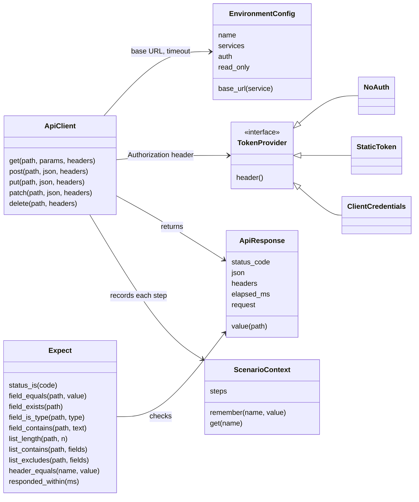

# api-qa-agent: low-level design

The high-level design ([architecture.md](architecture.md)) says what the utility is and why. This
document says how each part is built. It grows phase by phase: this version covers **phase 0**
(the mock service), **phase 1** (the Python framework and env_check), **phase 1b** (the Python
framework for QA teams) and **phase 2** (the REST Assured framework with TestNG); later phases get
their sections when they are designed.

## 1. Repository layout after phase 2

```
api-qa-agent/
  README.md  LICENSE  pyproject.toml     pip install -e .  installs mock_service and env_check
  mock_service/                  the reference API under test (FastAPI)
    __main__.py                  python -m mock_service  -> bookings on :8000, notifications on :8001
    bookings_app.py              create_bookings_app(): routes for auth, bookings, refunds, health
    notifications_app.py         create_notifications_app(): a stand-in dependency that can be switched down
    booking_store.py             BookingStore: in-memory bookings, reset for tests
    refund_rules.py              decide_refund(booking, cancelled_at): the 24-hour rule, in one place
    models.py                    request and response shapes (pydantic)
    errors.py                    one error shape for every failure
    openapi.json                 the OpenAPI description, exported from the app and committed
  env_check/                     is the environment ready? (one tool for every framework)
    __main__.py                  python -m env_check --env qa2 --dependencies teams/x/dependencies.yaml
    readiness.py                 check_environment() -> ReadinessReport
    settings.py                  reads environments.yaml and dependencies.yaml
  frameworks/
    python_api/                  installable on its own: pip install ./frameworks/python_api
      pyproject.toml
      api_test_framework/
        environment.py           EnvironmentConfig, load_environment()
        auth.py                  NoAuth, StaticToken, ClientCredentials
        api_client.py            ApiClient: get / post / put / patch / delete -> ApiResponse
        api_response.py          ApiResponse: status, json, headers, elapsed, value("a.b[0].c")
        expect.py                Expect(response).status_is(201).field_equals("status", "active") ...
        scenario_context.py      ScenarioContext: values carried between steps, and the step history
        test_data.py             load_rows() from JSON, CSV or Excel; new_passenger()
        pytest_plugin.py         fixtures, --env, markers, the chain shown on failure
      config/environments.yaml   mock, qa1, qa2, staging
      data/cancellation_boundaries.csv
      tests/examples/            one runnable example per feature, shaped like generated tests
      tests/unit/                the framework's own tests (no network)
    restassured_api/             the same framework in Java (REST Assured, TestNG): section 5
  tests/mock_service/            the mock service's own tests
  tests/env_check/               env_check's own tests (a fake network)
  docs/  architecture.md  lld.md  history/first-version.md
  .github/workflows/ci.yml
```

**Rules**
- `frameworks/python_api` never imports `mock_service`: expected values come from the test or
  its data, never from the service's code. A unit test fails the build if such an import appears.
- `env_check` and the framework read the same `environments.yaml` format. env_check reads only the
  service addresses, so it needs nothing from the framework (a Java team uses it too).
- Every folder has a README with how to run it in three commands or fewer.
- Tests make their own data and check their own items, never totals: they pass in any order and on
  an environment other teams are using.


## 2. Mock service (phase 0)

### 2.1 Endpoints

All `/bookings` endpoints need `Authorization: Bearer <token>`; without it, or with a wrong
token: **401**.

| Method and path | Request | Success | Other responses |
|---|---|---|---|
| `POST /auth/token` | `{client_id, client_secret}` | 200 `{access_token, token_type: "Bearer", expires_in: 3600}` | 401 wrong credentials |
| `POST /bookings` | `{passenger_name, email, amount, booked_at?}` | 201 the booking | 422 invalid field |
| `GET /bookings/{pnr}` | | 200 the booking | 404 |
| `GET /bookings?status=active&limit=20` | | 200 `{items: [...], count}` | 422 bad filter |
| `PUT /bookings/{pnr}` | `{passenger_name, email}` | 200 the booking | 404; 422 invalid, or `amount` sent (it can't change) |
| `DELETE /bookings/{pnr}` | | 204 | 404 |
| `POST /bookings/{pnr}/cancel` | `{cancelled_at?}` | 200 `{pnr, refund_allowed, refund_amount, reason}` | 404; 409 already cancelled; 422 cancelled before booked |
| `GET /bookings/{pnr}/refund` | | 200 `{pnr, refund_status: "refunded" \| "no_refund" \| "not_cancelled", refund_amount}` | 404 |
| `GET /health-check` | no token needed | 200 `{status: "ok", service: "bookings"}` | |
| `POST /test/reset` | no token needed | 204, every booking removed | 404 when test mode is off |

**Notifications stand-in (port 8001):** `GET /health-check` returns 200, or 503 while it is
switched down (`POST /test/state {"down": true}` or `NOTIFICATIONS_DOWN=1`). Bookings never call
it; it exists so env_check has a non-critical dependency to report on.

### 2.2 The booking

| Field | Rule |
|---|---|
| `pnr` | 6 upper-case letters and digits, made by the service, unique |
| `passenger_name` | 1 to 100 characters |
| `email` | a valid address |
| `amount` | a number, 0 or more; fixed after creation |
| `status` | `active` or `cancelled` |
| `booked_at` | ISO 8601 with a time zone; the caller may set it (so time boundaries can be tested), otherwise now |
| `cancelled_at` | empty until cancelled |

### 2.3 The refund rule (`refund_rules.decide_refund`)

| Hours from `booked_at` to `cancelled_at` | Result |
|---|---|
| less than 0 | 422: cancelled before it was booked |
| 0 to 24, **24 included** | refund allowed, full amount |
| more than 24 | no refund, amount 0 |

`cancelled_at` defaults to now. A second cancel returns 409 and changes nothing.

### 2.4 Errors, configuration, OpenAPI

- **One error shape** for every failure, including validation:
  `{"error": {"code": "booking_not_found", "message": "No booking with PNR AB12CD"}}`.
- **Configuration by environment variables:** `MOCK_CLIENT_ID` and `MOCK_CLIENT_SECRET`
  (defaults `demo-client` and `demo-secret`), `MOCK_TEST_MODE` (default on; turns `/test/*` on).
- **OpenAPI:** `python -m mock_service --export-openapi mock_service/openapi.json`. A test fails if the
  committed file differs from what the app produces, so the description never drifts.

## 3. env_check (phase 1)

### 3.1 Files

```yaml
# environments.yaml (shared with the framework)
environments:
  mock:
    services: {bookings: "http://localhost:8000", notifications: "http://localhost:8001"}
    auth: {type: client_credentials, service: bookings, token_path: /auth/token,
           client_id: demo-client, client_secret: demo-secret}   # plain values: mock only
    timeout_seconds: 10
    read_only: false
  qa1:
    services: {bookings: "https://qa1.example/bookings", notifications: "https://qa1.example/notify"}
    auth: {type: client_credentials, service: bookings, token_path: /auth/token,
           client_id_env: QA1_CLIENT_ID, client_secret_env: QA1_CLIENT_SECRET}
    read_only: false
  staging:
    services: {bookings: "https://staging.example/bookings"}
    auth: {type: static_token, token_env: STAGING_TOKEN}
    read_only: true
```

```yaml
# dependencies.yaml (one per team)
team: cancellations
checks:
  - service: bookings                 # host from environments.yaml
    critical: true
  - service: notifications
    path: /health-check               # default; set it when a service uses another path
    critical: false
```

Per check, with defaults: `path: /health-check`, `expect_status: 200`, `timeout_seconds: 5`,
`critical: true`. Per file: `attempts: 3`, `wait_seconds: 2` (doubled after each failed attempt).

### 3.2 Behaviour

1. Read both files; a missing service, a bad field or an unknown environment is a setup error.
2. For each check, `GET` (only `GET`) the service's path; retry a failed attempt after the wait.
3. Print one line per check (service, status, time, ok / DOWN) and a verdict.

| Exit code | Meaning |
|---|---|
| 0 | Ready (a non-critical service may be down; it is listed) |
| 2 | Setup problem: a file or setting is wrong |
| 3 | Not ready: a critical service is down. Not a test failure |

`--environments` and `--dependencies` default to `config/environments.yaml` and
`config/dependencies.yaml`. `--json` prints the same report as JSON for CI pages. From Python: `check_environment(name,
environments_path, dependencies_path) -> ReadinessReport`.

## 4. Python framework (phase 1)

### 4.1 Classes



| Class | Responsibility | Notes |
|---|---|---|
| `EnvironmentConfig` | One environment from `environments.yaml` | Chosen by `--env` or `API_ENV` (default `mock`) |
| `TokenProvider` | The `Authorization` header | `NoAuth`; `StaticToken` from an environment variable; `ClientCredentials` asks the token endpoint once per run and reuses it |
| `ApiClient` | One service's HTTP calls | Base URL from the environment; timeout; records every request and response in the scenario context; the token is masked in every log; `without_auth()` gives the same client with no token, for 401 tests |
| `ApiResponse` | What came back | `value("items[0].pnr")` reads any field by a dotted path; a missing field fails with the path and the body |
| `Expect` | Checks, chained | Each failure says what was expected, what came back, and the request that produced it. `list_contains` and `list_excludes` find the test's own items in a list, so a test never depends on totals |
| `ScenarioContext` | Values carried between steps, and the steps so far | Fresh for every test |

### 4.2 pytest plugin

| Gives | How |
|---|---|
| `--env qa2` | Same as `API_ENV=qa2` |
| Fixtures | `environment`; `api` (client for the default service); `api_for("notifications")`; `context` |
| Markers | `smoke`, `regression`, `functional`, `writes` (changes data: skipped on a `read_only` environment, with the reason in the report), `case("TC003")` (the case id, written into the JUnit report for traceability), `priority("P0")` (P0 to P3; phase 1b) |
| On failure | The whole chain: every step's request and response, then the expectation that broke |
| Report | `pytest --junitxml=reports/junit.xml` for CI; Allure for people (phase 1b, section 4.5) |

### 4.3 A test written with it

```python
@pytest.mark.functional
@pytest.mark.writes
@pytest.mark.case("TC003")
def test_cancel_exactly_at_24_hours_gets_a_full_refund(api, context):
    created = api.post("/bookings", json={**new_passenger(), "amount": 250,
                                           "booked_at": "2026-10-20T10:00:00Z"})
    Expect(created).status_is(201)
    context.remember("pnr", created.value("pnr"))

    cancelled = api.post(f"/bookings/{context.get('pnr')}/cancel",
                         json={"cancelled_at": "2026-10-21T10:00:00Z"})
    Expect(cancelled).status_is(200).field_equals("refund_allowed", True).field_equals("refund_amount", 250)
```

This is the shape `qa-agent generate` will write in phase 3: no logic, only steps and checks.

### 4.4 Examples (one per feature)

| Example | Shows |
|---|---|
| `test_get_booking.py` | GET: 200, 404, and 401 without a token |
| `test_booking_lifecycle.py` | Create → read → update → read → delete → read gives 404, the PNR carried between steps |
| `test_auth_chain.py` | Token → create → cancel → refund status, across three endpoints |
| `test_cancel_boundaries.py` | Data-driven from `data/cancellation_boundaries.csv`: 23:59, exactly 24:00, 24:01, cancelled before booked, already cancelled |
| `test_list_and_filters.py` | List with a filter: the test's own items found or absent; limit; a bad filter |
| `test_other_services.py` | `api_for("notifications")`: another service in the same environment |
| Environments | README: the same tests with `--env qa1`; a `writes` test skipped on a `read_only` environment |
| env_check | README: ready, then the notifications stand-in switched down (warned, still ready), then bookings stopped (exit 3) |

### 4.5 Phase 1b: what QA teams expect

| Feature | How | Notes |
|---|---|---|
| Allure report | `allure-pytest`; `pytest --alluredir=reports/allure-results`, then `allure generate` | Every step's request and response is attached (token masked); `case` becomes a label, `priority` the severity (P0 blocker, P1 critical, P2 normal, P3 minor), markers become tags. CI builds the HTML and keeps it |
| Smoke and priority | `@pytest.mark.smoke`, `@pytest.mark.priority("P0")` | `pytest -m smoke`; priority is also written into the JUnit report |
| Evidence of every test | `pytest --evidence reports/evidence` | One text file per test, pass or fail: result, then every request and response in order, token masked. For audits and sign-off |
| One retry, shown separately | `pytest --reruns 1` (`pytest-rerunfailures`) | A test that fails and then passes is listed under "Passed on retry: look at these", marked in the JUnit report and in Allure; never shown as a plain pass. CI runs with one retry; a laptop run has none unless asked |

## 5. REST Assured framework (phase 2)

The same shape as the Python framework, in the layout Java QA teams already know. Tests read the
same `environments.yaml` and `dependencies.yaml` (env_check runs before Maven, as in Python).

### 5.1 Layout

```
frameworks/restassured_api/
  pom.xml  mvnw  mvnw.cmd  .mvn/wrapper/      the Maven wrapper: no Maven install needed
  config/environments.yaml  config/dependencies.yaml
  data/cancellation_boundaries.csv  data/cancellation_boundaries.xlsx
  suites/smoke.xml  suites/regression.xml  suites/functional.xml       testng.xml suites by group
  src/main/java/apiqa/framework/
    config/      EnvironmentConfig, EnvironmentLoader (SnakeYAML; -Denv=qa2 or API_ENV)
    auth/        TokenProvider: NoAuth, StaticToken, ClientCredentials
    client/      ApiClient (REST Assured, a RequestSpecification per service), ApiResponse (value("items[0].pnr"))
    expect/      Expect: statusIs, fieldEquals, fieldExists, fieldIsType, fieldContains, listLength,
                 listContains, listExcludes, headerEquals, respondedWithin
    context/     ScenarioContext: remember, get, steps
    data/        TestData: rows from CSV, Excel (Apache POI) or JSON (Jackson); NewPassenger
    testng/      BaseTest, CaseId (annotation), Priority (annotation), ApiStepsListener, RetryOnce
  src/test/java/apiqa/examples/      one test class per feature, as in Python
```

### 5.2 TestNG pieces

| Piece | Responsibility |
|---|---|
| `BaseTest` | Before each test: the environment, a fresh `ScenarioContext`, `api()` and `apiFor("notifications")`; skips a test in group `writes` on a `read_only` environment, with the reason |
| Groups | `smoke`, `regression`, `functional`, `writes`; `mvn test -Dgroups=regression`, or a suite file: `mvn test -Dsurefire.suiteXmlFiles=suites/regression.xml` |
| `@CaseId("TC003")`, `@Priority("P0")` | Written into the reports by the listener (Allure label and severity; a TestNG attribute) |
| `ApiStepsListener` | On failure: every step's request and response, in order, into the log and Allure. Every test, pass or fail: an evidence file when `-Devidence=reports/evidence` is set |
| `RetryOnce` | `-Dretry=1`: a failed test runs once more; a pass on retry is listed separately and labelled in Allure |
| Data providers | `@DataProvider` reading `TestData.rows("data/cancellation_boundaries.csv")` (or `.xlsx`) |

### 5.3 A test written with it

```java
public class CancelRefundTest extends BaseTest {
    @Test(groups = {"regression", "writes"})
    @CaseId("TC003") @Priority("P1")
    public void cancelExactlyAt24HoursGetsAFullRefund() {
        ApiResponse created = api().post("/bookings", NewPassenger.with("amount", 250, "booked_at", "2026-01-15T10:00:00Z"));
        Expect.that(created).statusIs(201);
        String pnr = context().remember("pnr", created.value("pnr"));

        ApiResponse cancelled = api().post("/bookings/" + pnr + "/cancel", Map.of("cancelled_at", "2026-01-16T10:00:00Z"));
        Expect.that(cancelled).statusIs(200).fieldEquals("refund_allowed", true).fieldEquals("refund_amount", 250);
    }
}
```

### 5.4 Versions

Java 17; REST Assured 5.5; TestNG 7.10; Allure TestNG 2.29; SnakeYAML 2; Apache POI 5;
Jackson 2.17; Log4j 2.24 (for this project's own test runs; one version for every Log4j jar);
Maven Surefire 3.5. Built and tested in CI with `actions/setup-java`.

## 6. CI

| Job | Steps |
|---|---|
| `platform` | Install the reference API and env_check; their tests, including the OpenAPI drift test; start both services and check their health |
| `python-framework` | Install the mock and the framework; start both services in the background; `python -m env_check --env mock`; every test with plain `pytest`; then the examples with Allure, evidence, one retry and JUnit; build the single-file Allure report; keep the reports and the evidence |
| `restassured-framework` | Java 17 with the Maven cache; start the reference API; `python -m env_check --env mock`; `./mvnw test` with evidence and one retry (the framework's own tests, then every example); build the single-file Allure report; keep the reports and the evidence |

The two Python jobs run on Python 3.11 and 3.12, on every push and pull request. No API key anywhere.

## 7. Dependencies

| Part | Packages |
|---|---|
| mock_service | fastapi, uvicorn, pydantic |
| env_check | httpx, pyyaml |
| api_test_framework | httpx, pyyaml, pytest, openpyxl (Excel data), allure-pytest, pytest-rerunfailures |
| restassured-api-framework | rest-assured, testng, allure-testng, jackson-databind, snakeyaml, poi-ooxml (Excel data); log4j-core for its own test runs only |

## 8. The first version's code

| First version | Now |
|---|---|
| `docs/architecture.md` (its design decisions) | In [`docs/history/first-version.md`](history/first-version.md); the new design took its place |
| `adapters/`, `examples/`, `tests/test_engine.py` (its engine, five stack renderers, sample service and test) | Removed when phase 1 ended; in the git history. The reference stacks are on the later list |
| `requirements.txt` | Removed: `pip install -e .` installs the reference API and env_check |
| `core/` (its language-model steps) | Kept until phase 6 reworks it into the AI layer |
