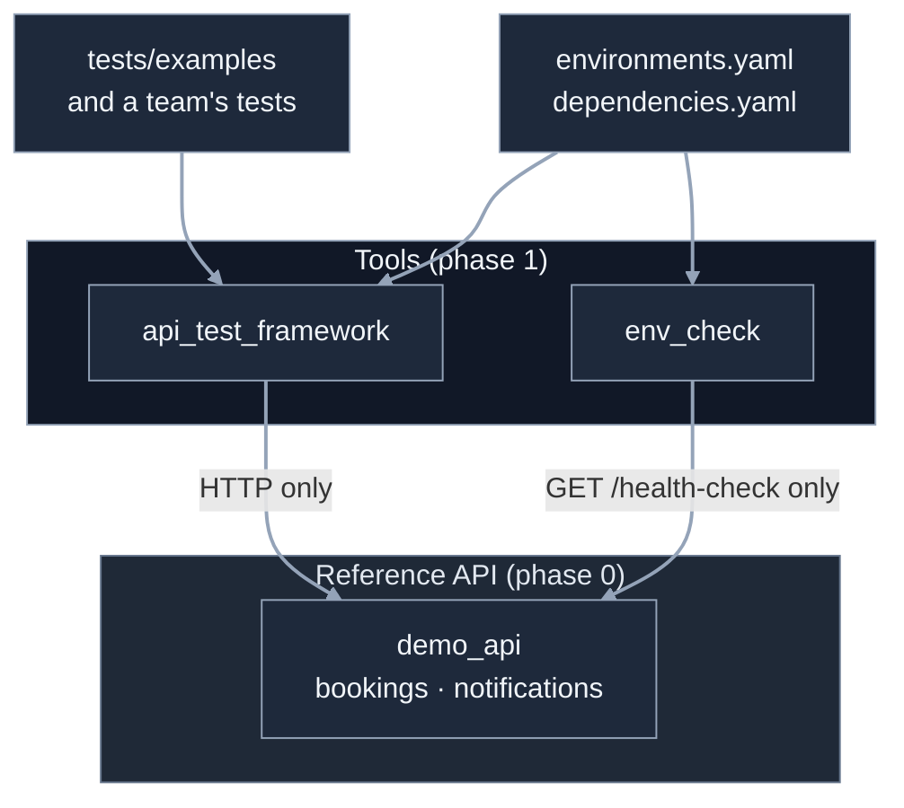
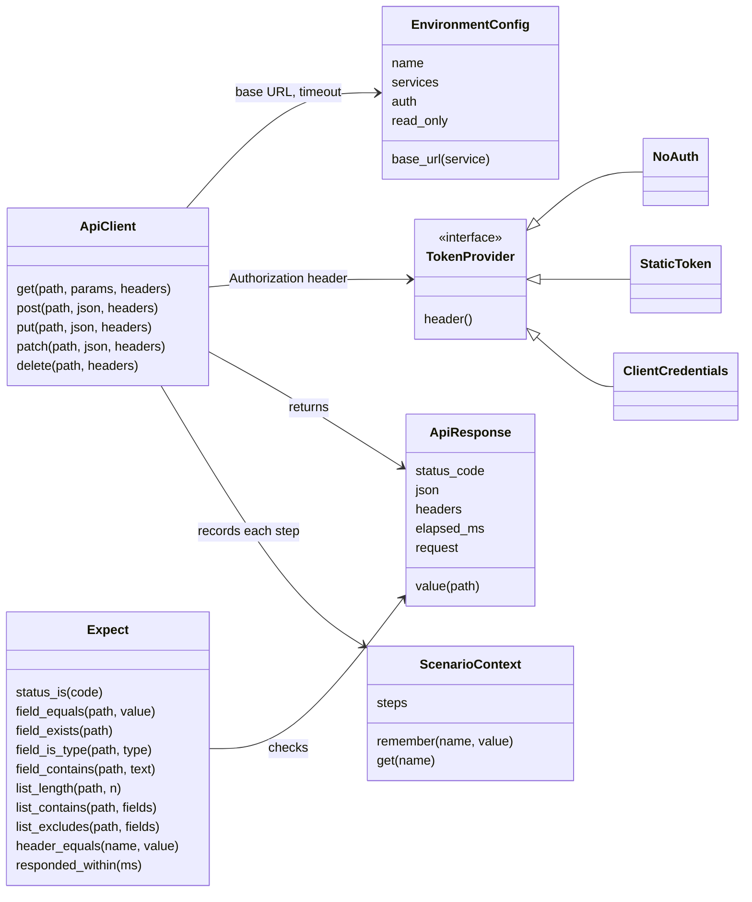
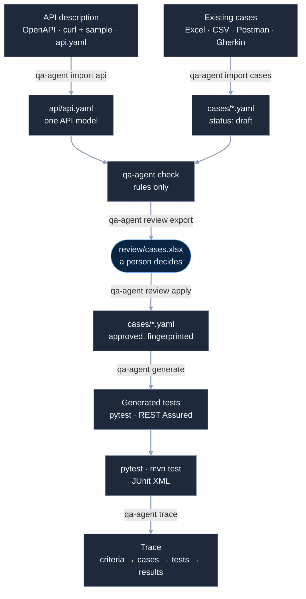

# api-qa-agent: low-level design

The high-level design ([architecture.md](architecture.md)) says what the utility is and why. This
document says how each part is built. It grows phase by phase: this version covers **phase 0**
(the demo API), **phase 1** (the Python framework and env_check), **phase 1b** (the Python
framework for QA teams), **phase 2** (the REST Assured framework with TestNG), **phase 3a**
(cases, importers, the review sheet, generated tests, trace and init) and **phase 3b** (drift check,
promote, bug-detection rate, teams, Petstore, Docker) and **phase 6** as built (the AI layer: drafting
criteria and cases, its guardrails, the audit log and the AI report); later phases get their sections
when they are designed.

## 1. Repository layout after phase 2

```
api-qa-agent/
  README.md  LICENSE  pyproject.toml     pip install -e .  installs demo_api and env_check
  demo_api/                  the reference API under test (FastAPI)
    __main__.py                  python -m demo_api  -> bookings on :8000, notifications on :8001
    bookings_app.py              create_bookings_app(): routes for auth, bookings, refunds, health
    notifications_app.py         create_notifications_app(): a stand-in dependency that can be switched down
    booking_store.py             BookingStore: in-memory bookings, reset for tests
    refund_rules.py              decide_refund(booking, cancelled_at): the 24-hour rule, in one place
    models.py                    request and response shapes (pydantic)
    errors.py                    one error shape for every failure
    openapi.json                 the OpenAPI description, exported from the app and committed
  env_check/                     is the environment ready? (one tool for every framework)
    __main__.py                  python -m env_check --env qa2 --dependencies teams/x/dependencies.yaml
    readiness.py                 check_environment() -> ReadinessReport
    settings.py                  reads environments.yaml and dependencies.yaml
  frameworks/
    python_api/                  installable on its own: pip install ./frameworks/python_api
      pyproject.toml
      api_test_framework/
        environment.py           EnvironmentConfig, load_environment()
        auth.py                  NoAuth, StaticToken, ClientCredentials
        api_client.py            ApiClient: get / post / put / patch / delete -> ApiResponse
        api_response.py          ApiResponse: status, json, headers, elapsed, value("a.b[0].c")
        expect.py                Expect(response).status_is(201).field_equals("status", "active") ...
        scenario_context.py      ScenarioContext: values carried between steps, and the step history
        test_data.py             load_rows() from JSON, CSV or Excel; new_passenger()
        pytest_plugin.py         fixtures, --env, markers, the chain shown on failure
      config/environments.yaml   demo, qa1, qa2, staging
      data/cancellation_boundaries.csv
      tests/examples/            one runnable example per feature, shaped like generated tests
      tests/unit/                the framework's own tests (no network)
    restassured_api/             the same framework in Java (REST Assured, TestNG): section 5
  tests/demo_api/            the demo API's own tests
  tests/env_check/               env_check's own tests (a fake network)
  docs/  architecture.md  lld.md  history/first-version.md
  .github/workflows/ci.yml
```

**Rules**
- `frameworks/python_api` never imports `demo_api`: expected values come from the test or
  its data, never from the service's code. A unit test fails the build if such an import appears.
- `env_check` and the framework read the same `environments.yaml` format. env_check reads only the
  service addresses, so it needs nothing from the framework (a Java team uses it too).
- Every folder has a README with how to run it in three commands or fewer.
- Tests make their own data and check their own items, never totals: they pass in any order and on
  an environment other teams are using.



## 2. Demo API (phase 0)

### 2.1 Endpoints

All `/bookings` endpoints need `Authorization: Bearer <token>`; without it, or with a wrong
token: **401**.

| Method and path | Request | Success | Other responses |
|---|---|---|---|
| `POST /auth/token` | `{client_id, client_secret}` | 200 `{access_token, token_type: "Bearer", expires_in: 3600}` | 401 wrong credentials |
| `POST /bookings` | `{passenger_name, email, amount, booked_at?}` | 201 the booking | 422 invalid field |
| `GET /bookings/{pnr}` | | 200 the booking | 404 |
| `GET /bookings?status=active&limit=20` | | 200 `{items: [...], count}` | 422 bad filter |
| `PUT /bookings/{pnr}` | `{passenger_name, email}` | 200 the booking | 404; 422 invalid, or `amount` sent (it can't change) |
| `DELETE /bookings/{pnr}` | | 204 | 404 |
| `POST /bookings/{pnr}/cancel` | `{cancelled_at?}` | 200 `{pnr, refund_allowed, refund_amount, reason}` | 404; 409 already cancelled; 422 cancelled before booked |
| `GET /bookings/{pnr}/refund` | | 200 `{pnr, refund_status: "refunded" \| "no_refund" \| "not_cancelled", refund_amount}` | 404 |
| `GET /health-check` | no token needed | 200 `{status: "ok", service: "bookings"}` | |
| `POST /test/reset` | no token needed | 204, every booking removed | 404 when test mode is off |

**Notifications stand-in (port 8001):** `GET /health-check` returns 200, or 503 while it is
switched down (`POST /test/state {"down": true}` or `NOTIFICATIONS_DOWN=1`). Bookings never call
it; it exists so env_check has a non-critical dependency to report on.

### 2.2 The booking

| Field | Rule |
|---|---|
| `pnr` | 6 upper-case letters and digits, made by the service, unique |
| `passenger_name` | 1 to 100 characters |
| `email` | a valid address |
| `amount` | a number, 0 or more; fixed after creation |
| `status` | `active` or `cancelled` |
| `booked_at` | ISO 8601 with a time zone; the caller may set it (so time boundaries can be tested), otherwise now |
| `cancelled_at` | empty until cancelled |

### 2.3 The refund rule (`refund_rules.decide_refund`)

| Hours from `booked_at` to `cancelled_at` | Result |
|---|---|
| less than 0 | 422: cancelled before it was booked |
| 0 to 24, **24 included** | refund allowed, full amount |
| more than 24 | no refund, amount 0 |

`cancelled_at` defaults to now. A second cancel returns 409 and changes nothing.

### 2.4 Errors, configuration, OpenAPI

- **One error shape** for every failure, including validation:
  `{"error": {"code": "booking_not_found", "message": "No booking with PNR AB12CD"}}`.
- **Configuration by environment variables:** `DEMO_CLIENT_ID` and `DEMO_CLIENT_SECRET`
  (defaults `demo-client` and `demo-secret`), `DEMO_TEST_MODE` (default on; turns `/test/*` on).
- **OpenAPI:** `python -m demo_api --export-openapi demo_api/openapi.json`. A test fails if the
  committed file differs from what the app produces, so the description never drifts.

## 3. env_check (phase 1)

### 3.1 Files

```yaml
# environments.yaml (shared with the framework)
environments:
  demo:
    services: {bookings: "http://localhost:8000", notifications: "http://localhost:8001"}
    auth: {type: client_credentials, service: bookings, token_path: /auth/token,
           client_id: demo-client, client_secret: demo-secret}   # plain values: demo only
    timeout_seconds: 10
    read_only: false
  qa1:
    services: {bookings: "https://qa1.example/bookings", notifications: "https://qa1.example/notify"}
    auth: {type: client_credentials, service: bookings, token_path: /auth/token,
           client_id_env: QA1_CLIENT_ID, client_secret_env: QA1_CLIENT_SECRET}
    read_only: false
  staging:
    services: {bookings: "https://staging.example/bookings"}
    auth: {type: static_token, token_env: STAGING_TOKEN}
    read_only: true
```

```yaml
# dependencies.yaml (one per team)
team: cancellations
checks:
  - service: bookings                 # host from environments.yaml
    critical: true
  - service: notifications
    path: /health-check               # default; set it when a service uses another path
    critical: false
```

Per check, with defaults: `path: /health-check`, `expect_status: 200`, `timeout_seconds: 5`,
`critical: true`. Per file: `attempts: 3`, `wait_seconds: 2` (doubled after each failed attempt).

### 3.2 Behaviour

1. Read both files; a missing service, a bad field or an unknown environment is a setup error.
2. For each check, `GET` (only `GET`) the service's path; retry a failed attempt after the wait.
3. Print one line per check (service, status, time, ok / DOWN) and a verdict.

| Exit code | Meaning |
|---|---|
| 0 | Ready (a non-critical service may be down; it is listed) |
| 2 | Setup problem: a file or setting is wrong |
| 3 | Not ready: a critical service is down. Not a test failure |

`--environments` and `--dependencies` default to `config/environments.yaml` and
`config/dependencies.yaml`. `--json` prints the same report as JSON for CI pages. From Python: `check_environment(name,
environments_path, dependencies_path) -> ReadinessReport`.

## 4. Python framework (phase 1)

### 4.1 Classes



| Class | Responsibility | Notes |
|---|---|---|
| `EnvironmentConfig` | One environment from `environments.yaml` | Chosen by `--env` or `API_ENV` (default `demo`) |
| `TokenProvider` | The `Authorization` header | `NoAuth`; `StaticToken` from an environment variable; `ClientCredentials` asks the token endpoint once per run and reuses it |
| `ApiClient` | One service's HTTP calls | Base URL from the environment; timeout; records every request and response in the scenario context; the token is masked in every log; `without_auth()` gives the same client with no token, for 401 tests |
| `ApiResponse` | What came back | `value("items[0].pnr")` reads any field by a dotted path; a missing field fails with the path and the body |
| `Expect` | Checks, chained | Each failure says what was expected, what came back, and the request that produced it. `list_contains` and `list_excludes` find the test's own items in a list, so a test never depends on totals |
| `ScenarioContext` | Values carried between steps, and the steps so far | Fresh for every test |

### 4.2 pytest plugin

| Gives | How |
|---|---|
| `--env qa2` | Same as `API_ENV=qa2` |
| Fixtures | `environment`; `api` (client for the default service); `api_for("notifications")`; `context` |
| Markers | `smoke`, `regression`, `functional`, `writes` (changes data: skipped on a `read_only` environment, with the reason in the report), `case("TC003")` (the case id, written into the JUnit report for traceability), `priority("P0")` (P0 to P3; phase 1b) |
| On failure | The whole chain: every step's request and response, then the expectation that broke |
| Report | `pytest --junitxml=reports/junit.xml` for CI; Allure for people (phase 1b, section 4.5) |

### 4.3 A test written with it

```python
@pytest.mark.functional
@pytest.mark.writes
@pytest.mark.case("TC003")
def test_cancel_exactly_at_24_hours_gets_a_full_refund(api, context):
    created = api.post("/bookings", json={**new_passenger(), "amount": 250,
                                           "booked_at": "2026-10-20T10:00:00Z"})
    Expect(created).status_is(201)
    context.remember("pnr", created.value("pnr"))

    cancelled = api.post(f"/bookings/{context.get('pnr')}/cancel",
                         json={"cancelled_at": "2026-10-21T10:00:00Z"})
    Expect(cancelled).status_is(200).field_equals("refund_allowed", True).field_equals("refund_amount", 250)
```

This is the shape `qa-agent generate` will write in phase 3: no logic, only steps and checks.

### 4.4 Examples (one per feature)

| Example | Shows |
|---|---|
| `test_get_booking.py` | GET: 200, 404, and 401 without a token |
| `test_booking_lifecycle.py` | Create → read → update → read → delete → read gives 404, the PNR carried between steps |
| `test_auth_chain.py` | Token → create → cancel → refund status, across three endpoints |
| `test_cancel_boundaries.py` | Data-driven from `data/cancellation_boundaries.csv`: 23:59, exactly 24:00, 24:01, cancelled before booked, already cancelled |
| `test_list_and_filters.py` | List with a filter: the test's own items found or absent; limit; a bad filter |
| `test_other_services.py` | `api_for("notifications")`: another service in the same environment |
| Environments | README: the same tests with `--env qa1`; a `writes` test skipped on a `read_only` environment |
| env_check | README: ready, then the notifications stand-in switched down (warned, still ready), then bookings stopped (exit 3) |

### 4.5 Phase 1b: what QA teams expect

| Feature | How | Notes |
|---|---|---|
| Allure report | `allure-pytest`; `pytest --alluredir=reports/allure-results`, then `allure generate` | Every step's request and response is attached (token masked); `case` becomes a label, `priority` the severity (P0 blocker, P1 critical, P2 normal, P3 minor), markers become tags. CI builds the HTML and keeps it |
| Smoke and priority | `@pytest.mark.smoke`, `@pytest.mark.priority("P0")` | `pytest -m smoke`; priority is also written into the JUnit report |
| Evidence of every test | `pytest --evidence reports/evidence` | One text file per test, pass or fail: result, then every request and response in order, token masked. For audits and sign-off |
| One retry, shown separately | `pytest --reruns 1` (`pytest-rerunfailures`) | A test that fails and then passes is listed under "Passed on retry: look at these", marked in the JUnit report and in Allure; never shown as a plain pass. CI runs with one retry; a laptop run has none unless asked |

## 5. REST Assured framework (phase 2)

The same shape as the Python framework, in the layout Java QA teams already know. Tests read the
same `environments.yaml` and `dependencies.yaml` (env_check runs before Maven, as in Python).

### 5.1 Layout

```
frameworks/restassured_api/
  pom.xml  mvnw  mvnw.cmd  .mvn/wrapper/      the Maven wrapper: no Maven install needed
  config/environments.yaml  config/dependencies.yaml
  data/cancellation_boundaries.csv  data/cancellation_boundaries.xlsx
  suites/smoke.xml  suites/regression.xml  suites/functional.xml       testng.xml suites by group
  src/main/java/apiqa/framework/
    config/      EnvironmentConfig, EnvironmentLoader (SnakeYAML; -Denv=qa2 or API_ENV)
    auth/        TokenProvider: NoAuth, StaticToken, ClientCredentials
    client/      ApiClient (REST Assured, a RequestSpecification per service), ApiResponse (value("items[0].pnr"))
    expect/      Expect: statusIs, fieldEquals, fieldExists, fieldIsType, fieldContains, listLength,
                 listContains, listExcludes, headerEquals, respondedWithin
    context/     ScenarioContext: remember, get, steps
    data/        TestData: rows from CSV, Excel (Apache POI) or JSON (Jackson); NewPassenger
    testng/      BaseTest, CaseId (annotation), Priority (annotation), ApiStepsListener, RetryOnce
  src/test/java/apiqa/examples/      one test class per feature, as in Python
```

### 5.2 TestNG pieces

| Piece | Responsibility |
|---|---|
| `BaseTest` | Before each test: the environment, a fresh `ScenarioContext`, `api()` and `apiFor("notifications")`; skips a test in group `writes` on a `read_only` environment, with the reason |
| Groups | `smoke`, `regression`, `functional`, `writes`; `mvn test -Dgroups=regression`, or a suite file: `mvn test -Dsurefire.suiteXmlFiles=suites/regression.xml` |
| `@CaseId("TC003")`, `@Priority("P0")` | Written into the reports by the listener (Allure label and severity; a TestNG attribute) |
| `ApiStepsListener` | On failure: every step's request and response, in order, into the log and Allure. Every test, pass or fail: an evidence file when `-Devidence=reports/evidence` is set |
| `RetryOnce` | `-Dretry=1`: a failed test runs once more; a pass on retry is listed separately and labelled in Allure |
| Data providers | `@DataProvider` reading `TestData.rows("data/cancellation_boundaries.csv")` (or `.xlsx`) |

### 5.3 A test written with it

```java
public class CancelRefundTest extends BaseTest {
    @Test(groups = {"regression", "writes"})
    @CaseId("TC003") @Priority("P1")
    public void cancelExactlyAt24HoursGetsAFullRefund() {
        ApiResponse created = api().post("/bookings", NewPassenger.with("amount", 250, "booked_at", "2026-01-15T10:00:00Z"));
        Expect.that(created).statusIs(201);
        String pnr = context().remember("pnr", created.value("pnr"));

        ApiResponse cancelled = api().post("/bookings/" + pnr + "/cancel", Map.of("cancelled_at", "2026-01-16T10:00:00Z"));
        Expect.that(cancelled).statusIs(200).fieldEquals("refund_allowed", true).fieldEquals("refund_amount", 250);
    }
}
```

### 5.4 Versions

Java 17; REST Assured 5.5; TestNG 7.10; Allure TestNG 2.29; SnakeYAML 2; Apache POI 5;
Jackson 2.17; Log4j 2.24 (for this project's own test runs; one version for every Log4j jar);
Maven Surefire 3.5. Built and tested in CI with `actions/setup-java`.

## 6. CI

| Job | Steps |
|---|---|
| `platform` | Install the reference API, env_check and qa-agent; their tests, including the OpenAPI drift test and qa-agent's own; `qa-agent check` on the example project; start both services and check their health |
| `python-framework` | Install the demo API and the framework; start both services in the background; `python -m env_check --env demo`; every test with plain `pytest`; then the examples with Allure, evidence, one retry and JUnit; build the single-file Allure report; keep the reports and the evidence |
| `restassured-framework` | Java 17 with the Maven cache; start the reference API; `python -m env_check --env demo`; `./mvnw test` with evidence and one retry (the framework's own tests, then every example); build the single-file Allure report; keep the reports and the evidence |
| `qa-agent` | Install both frameworks; the example project end to end with `run_all.sh` (rebuilt from its inputs and compared, both frameworks' generated tests, the trace); a new project from `qa-agent init` runs, in each framework; keep the trace (section 9.12) |

The two Python jobs run on Python 3.11 and 3.12, on every push and pull request. No API key anywhere.

## 7. Dependencies

| Part | Packages |
|---|---|
| demo_api | fastapi, uvicorn, pydantic |
| env_check | httpx, pyyaml |
| api_test_framework | httpx, pyyaml, pytest, openpyxl (Excel data), allure-pytest, pytest-rerunfailures |
| restassured-api-framework | rest-assured, testng, allure-testng, jackson-databind, snakeyaml, poi-ooxml (Excel data); log4j-core for its own test runs only |
| qa_agent | pyyaml, openpyxl (Excel data files and sheets); jinja2 with the renderers (9.7) |

## 8. The first version's code

| First version | Now |
|---|---|
| `docs/architecture.md` (its design decisions) | In [`docs/history/first-version.md`](history/first-version.md); the new design took its place |
| `adapters/`, `examples/`, `tests/test_engine.py` (its engine, five framework renderers, sample service and test) | Removed when phase 1 ended; in the git history. The reference frameworks are on the later list |
| `requirements.txt` | Removed: `pip install -e .` installs the reference API and env_check |
| `core/` (its language-model steps) | Removed in phase 6: the AI layer (`qa_agent/ai/`) replaces it |

## 9. Phase 3a: cases, importers, the review sheet, generated tests, trace, init

No model and no API key anywhere in this phase. At its end a team can bring its API description,
its acceptance criteria and its existing cases, approve the cases in an Excel sheet, and get
runnable tests in pytest or REST Assured, traced back to the criteria.



### 9.1 A team's project

What `qa-agent init` creates, and what every other command reads. The same shape for every team.

```
bookings-team/
  qa-agent.yaml                 team: bookings · service: bookings · frameworks: [pytest] · case_id_prefix: TC
  api/api.yaml                  the API model (imported from OpenAPI or curl, or written by hand)
  api/source/                   what the team brought: openapi.json, *.curl with a sample response
  acceptance-criteria.yaml                 acceptance criteria: id and text
  existing/                     the team's own cases, as they are: Excel, CSV, Postman, .feature
  cases/cancellation.yaml       the cases of one feature, in one file: the source of truth
  data/                         data files for data-driven cases
  review/cases.xlsx             the review sheet
  config/environments.yaml  config/dependencies.yaml
  tests/generated/              Python framework: generated, never edited by hand
  src/test/java/generated/      REST Assured framework: generated, never edited by hand
  reports/                      trace.md, trace.xlsx (not committed)
```

### 9.2 The case format

```yaml
# cases/cancellation.yaml
feature: Cancellation and refund
cases:
  - id: TC003
    title: Cancel exactly at 24 hours gets a full refund
    criteria: [AC-2]
    priority: P1                     # P0 to P3
    suite: functional                # functional or regression (promote, phase 3b)
    tags: [smoke]                    # optional; become markers or TestNG groups
    data_file: data/cancellation_boundaries.csv   # optional: one run per row, values as {{row.column}}
    source: {format: excel-api, file: existing/booking_cases.xlsx, row: 7}
    steps:
      - request:
          method: POST
          path: /bookings
          body: {passenger_name: "Asha Rao {{unique}}", email: "asha.{{unique}}@testdata.example",
                 amount: 250, booked_at: "2026-10-20T10:00:00Z"}
        expect: {status: 201}
        capture: {pnr: pnr}          # name: path in the response
      - request: {method: POST, path: "/bookings/{{pnr}}/cancel", body: {cancelled_at: "2026-10-21T10:00:00Z"}}
        expect:
          status: 200
          fields: {refund_allowed: true, refund_amount: 250}
    review: {status: approved, by: qa-lead, date: 2026-10-21, comment: "", fingerprint: 9c1e…}
  - id: TC004
    ...
```

| Part | Allowed |
|---|---|
| `request` | `method`, `path`, `query`, `headers`, `body`; `service` (default: the main service); `auth: none` for a call without a token |
| `expect` | `status`, `fields` (equals), `exists`, `types`, `contains`, `list_length`, `list_contains`, `list_excludes`, `headers`, `max_response_ms`: exactly what both frameworks' `Expect` offers, so every case renders in both |
| Values | `{{name}}` captured earlier in the case; `{{row.column}}` from the data file (in a request or an expectation; a data-driven `status` may be `"{{row.expected_status}}"`); `{{unique}}` six characters (`7f3a9c`), new in each test, so tests don't collide on a shared environment |
| `manual_steps` | Steps in plain words, for a case imported from a manual sheet or Gherkin (9.4). Such a case is kept and traced but cannot be generated until it has `steps` |
| `review` | Written only by `review apply`. `status`: `draft`, `approved`, `changes_needed` or `rejected` |

- **One file per feature or resource** (`cases/cancellation.yaml`), holding a list of cases, as
  Gherkin, Karate and Postman do. Each case keeps its own id, review and fingerprint, so approval
  stays per case.
- **The fingerprint** is a hash of the case's id, steps and expectations, and of its data file's name
  and its rows as read (so a re-save by Excel, a byte-order mark or Windows line endings change nothing), since a data-driven case keeps its expected results there. A case edited after
  approval no longer matches its fingerprint: `check` reports it, and `generate` treats it as a
  draft until it is approved again. Nothing unapproved becomes code.
- A step with no expectation is an error: a test must check something.
- qa-agent rewrites case files (on import and review) in one layout, so remarks go in `notes`,
  not in YAML comments, which would be lost.

### 9.3 The API model and its importers

One small file, `api/api.yaml`, whatever the team started from. People can read and edit it, and
every other command reads only this.

```yaml
services:
  bookings:
    operations:
      - {method: POST, path: /bookings, summary: Create a booking,
         body_required: [passenger_name, email, amount, booked_at], responses: [201, 422]}
      - {method: POST, path: "/bookings/{pnr}/cancel", responses: [200, 404, 409, 422]}
```

| `qa-agent import api <file>` | Reads |
|---|---|
| OpenAPI 3 (`.json`, `.yaml`) | Paths, methods, summaries, required body fields (following `$ref`), documented response codes |
| curl (`.curl` or `.txt`: the command, then a sample response after a line `### response`) | Method, path (host removed), the sample response's status. A path part that looks like a value (`AB12CD`, `1042`, a UUID) becomes a parameter, `{id}`, and is reported. Headers are not kept, so a token in the curl never reaches the repository. A curl doesn't say which body fields are required, so it adds none |
| `api.yaml` | Nothing to convert: the team writes it by hand |

Several sources merge into one model; an operation found twice is kept once.

### 9.4 Importers of existing cases

`qa-agent import cases existing/<file>` adds the cases to `cases/<name>.yaml`, named after the
Excel sheet (each sheet is a feature), the CSV file, the Postman collection or the Gherkin feature
(or `--into cases/cancellation.yaml`), each with `review.status: draft` and its `source` (file,
sheet and row, item or scenario). An id already in the project is skipped and reported, unless
`--overwrite`. Anything that can't be read is reported, never guessed: a row with no Case ID, a Body
that isn't JSON, a priority qa-agent doesn't know (set to P2), a Postman script line. A CSV in
Excel's own encoding ("CSV", not "CSV UTF-8") is read too; a damaged .xlsx is refused with what to do,
not a traceback. `check` warns when a request carries something that looks like a key, token or
secret, since case files are committed.

**Case ids.** The team's own ids are kept, never renumbered: TestRail, Jira and old reports know a
case by them. They come from a sheet's Case ID or ID column, a Gherkin tag `@TC040`, or a Postman
folder or request named `TC030 Create and read`. A case with no id gets the next free one with the
project's prefix (`case_id_prefix: TC` in `qa-agent.yaml`; after TC041 comes TC042), worked out after
every file is read, so the order of the files doesn't matter. Imported again, it keeps that id (it is
matched by its source).

**Priorities.** P0 to P3, or the words teams use: Blocker and Critical are P0, High and Major P1,
Medium and Normal P2, Low, Minor and Trivial P3.

| Format | What becomes of it |
|---|---|
| **Excel or CSV, API layout** (one row per step: Case ID, Title, Criteria, Priority, Tags, Step, Method, Path, Body, Expected Status, Expected Fields, Capture) | A full case, ready to generate. Body is JSON; Expected Fields and Capture are `name=value; name=value`. The layout is in `qa-agent init`'s project as a blank sheet |
| **Excel or CSV, manual layout** (ID, Title, Preconditions, Steps, Expected Result, Priority, Criteria) | A case with `manual_steps` (`Before: …`, each step, `Expected: …`; numbered steps in one cell are split): kept, traced to its criteria, flagged "needs steps". A person writes the steps; in phase 6 the AI drafts them |
| **Postman collection (v2.1 or v2.0)** | A folder whose name starts with a case id (`TC030 Create and read`) is one case, its requests the steps, in order; any other folder only groups (folders by feature), and each request in it is a case, with the id its name starts with. The host (`{{baseUrl}}`) is dropped from the path, `:pnr` becomes `{{pnr}}`, Postman's dynamic values (`{{$guid}}`, `{{$randomInt}}`) become `{{unique}}`; Authorization and Cookie headers are never kept. `pm.response.to.have.status(…)`, `pm.expect(json.x).to.eql(…)`, `.to.include(…)`, `pm.expect(pm.response.responseTime).to.be.below(…)` and `pm.environment.set("x", json.y)` become `status`, `fields`, `contains`, `max_response_ms` and `capture`. Any other script line is kept in the case's notes, shown in the review sheet, and reported |
| **Gherkin (`.feature`)** | One scenario is one case, with the Background's steps first; tags `@TC040`, `@P1`, `@AC-2` become the id, priority and criteria, other tags (the feature's too) stay tags. A scenario whose every step is in the fixed phrasing below becomes `steps`; any other scenario is kept whole as `manual_steps` (half a scenario as steps would run without its preconditions). A Scenario Outline's Examples become a data file, `data/<feature>-<id>.csv`, and `<column>` becomes `{{row.column}}`; several Examples tables become one file (a table with other columns is left out, and said) |

The fixed Gherkin phrasing, the same one phase 3c generates (so a feature file can go both ways):
`When I POST "/bookings" with` (a doc string body) · `Then the status is 201` ·
`And "refund_amount" is 250` · `And I remember "pnr" as "pnr"`.

### 9.5 `qa-agent check`: rules only

| Rule | Level |
|---|---|
| The case file doesn't match the format; two cases share an id | Error |
| Different ids, the same steps (requests, expectations, captures, data file) or the same manual steps (case and spacing aside); rejected cases and cases with no steps left out | Warning on each repeat, naming the case with the lowest id; one line per group on the console, and a count of groups. A reviewer decides which to keep. Exact matches only: "nearly the same" would warn about cases that differ on purpose. A hash per case, so 5,000 cases compare in well under a second |
| A step has no expectation | Error |
| Every step checks only a status and the case ends in success (2xx): a wrong answer passes | Warning: add `fields`, `exists` or `types` (a case that ends in a refusal or a 404 is not flagged: that status is its point) |
| `{{name}}` used before it is captured; `{{row.x}}` with no data file, or no column `x` | Error |
| The method and path are not in `api/api.yaml` | Error |
| The expected status is not one the API documents for that operation | Warning |
| A required body field (from the API model) is missing | Warning (a negative test may leave it out on purpose) |
| A criterion id not in `acceptance-criteria.yaml`; a case with no criterion | Error · Warning |
| Changed after approval (fingerprint) | Warning: "review again" |
| Only `manual_steps` | Info: "needs steps" |
| No `api/api.yaml` | Info: the rules that need the API are skipped, and say so |

A rejected case is left alone. Each finding names the case, the step and the fix. Exit 0 with no errors, 1 with errors, 2 when the
project can't be read. The findings also go into the review sheet.

### 9.6 The review sheet

`qa-agent review export` writes `review/cases.xlsx`, one row per case not yet approved (or every
case with `--all`). It won't write over a sheet that holds a case or criterion decision, or an answer,
that isn't applied yet: that is a reviewer's work (`--force` starts a new sheet anyway).

| ID | Case file | Status | Title | Criteria | Priority | Suite | Tags | Steps | Expected | Check findings | **Decision** | **Reviewer** | **Date** | **Comment** |
|---|---|---|---|---|---|---|---|---|---|---|---|---|---|---|

Rows are in id order (TC001, TC002, ... TC010). A rejected case is not exported again (unless
`--all`). A second sheet, "How to review", says what to do in five lines. A case in words shows its
steps in Steps and its expected result in words (a manual sheet's Expected Result, a Gherkin
`Then`) in Expected, marked "needs steps".

- **Steps** and **Expected** are readable text, one line per step (`POST /bookings → 201, remember pnr`),
  greyed and locked: the steps themselves are changed in the case file, so a sheet can never
  produce a case that doesn't parse.
- The reviewer may change Title, Criteria, Priority, Suite and Tags (Priority and Suite are
  drop-downs), and fills **Decision** (a drop-down: Approve, Changes needed, Reject), **Reviewer**,
  **Date** (28-10-2026, or Excel's own date; a real date; today when left empty; kept as 2026-10-28 in
  the case file, so it sorts) and **Comment**. Check findings and a Postman case's unread
  script lines are in the sheet, so the reviewer sees them.
- A hidden column holds each case's fingerprint at export. `qa-agent review apply` applies a row
  only if the case is unchanged since export; otherwise it reports "the case changed after this
  sheet was made: export again".
- A decision needs a Reviewer; Changes needed and Reject need a Comment, so the author sees why.
- Approve writes `review: {status: approved, by, date, fingerprint}`. A case with steps only in
  words, or with check errors (after the reviewer's edits), can't be approved: the row is refused
  with the reason. `review apply` exits 1 when any row is refused.
- Committed in the team's repository: the record of who approved what, and when.

### 9.7 Renderers and `qa-agent generate`

One renderer per framework: a small Python class that writes each step the way a person uses that
framework, and a Jinja2 template for the file around the tests (`qa_agent/renderers/templates/`).
Only approved cases with a matching fingerprint are written; one test file per case file, one test
per case, in every framework the project lists. Same cases, same files, every time.

The case TC003 (`cases/cancellation.yaml`), in pytest (`tests/generated/test_cancellation.py`):

```python
@pytest.mark.functional
@pytest.mark.negative
@pytest.mark.writes
@pytest.mark.case("TC003")
@pytest.mark.priority("P1")
def test_tc003_a_second_cancel_is_refused(api, context):
    """A second cancel is refused. Criteria: AC-4."""
    unique = unique_id()
    # 1. POST /bookings
    response = api.post("/bookings", json={
        "passenger_name": f"Asha Rao {unique}",
        ...
    })
    Expect(response).status_is(201)
    context.remember("pnr", response.value("pnr"))
    ...
```

In REST Assured (`src/test/java/generated/CancellationTest.java`):

```java
    /** A second cancel is refused. Criteria: AC-4. */
    @Test(groups = {"functional", "negative", "writes"})
    @CaseId("TC003") @Priority("P1")
    public void tc003ASecondCancelIsRefused() {
        String unique = TestData.uniqueId();
        ApiResponse response;
        // 1. POST /bookings
        response = api().post("/bookings", Map.of(
                "passenger_name", "Asha Rao " + unique,
                ...));
        Expect.that(response).statusIs(201);
        context().remember("pnr", response.value("pnr"));
        ...
    }
```

| Part of a case | pytest | REST Assured |
|---|---|---|
| Suite and tags | Markers; a tag becomes `@pytest.mark.<tag>`, registered in a generated `tests/generated/conftest.py` | TestNG groups |
| A case that changes data | `writes` marker | `writes` group: skipped on a read-only environment |
| `{{unique}}`, `{{pnr}}`, `{{row.x}}` | `unique_id()`, `context.get("pnr")`, `row["x"]` (f-strings inside text) | `TestData.uniqueId()`, `context().get("pnr")`, `row.get("x")` (`+` inside text) |
| Data | `@pytest.mark.parametrize("row", load_rows(...))`, named after a `case` column when there is one | `@DataProvider` with `TestData.rows(...)` |
| Another service; no token | `api_for("notifications")`; `.without_auth()` | `apiFor("notifications")`; `.withoutAuth()` |
| Query and headers | `params=`, `headers=` (or `api.request(...)` where the shortcut has no place for them) | `get(path, params, headers)`, `post(path, body, headers)`, or `request(...)` |
| Bodies | Python dicts, one field per line when long | `Map.of` (`Map.ofEntries` past ten fields), `List.of`, one field per line when long |

- The test's name starts with the case id (`test_tc003_…`, `tc003…`): that is how `trace` finds it.
- A value a framework can't express is refused for that framework with the reason, never written wrong:
  a `null` in a body can't go in Java's `Map.of`. `generate` then exits 1.
- The output folders belong to qa-agent. A generated file whose cases are no longer approved is
  removed; a file qa-agent didn't write (no generated header) is left alone, and reported.
- Both frameworks have `unique_id()` (Python) and `TestData.uniqueId()` (Java), six characters.
- The generated Java was compiled during the build against the framework's signatures; CI compiles
  and runs it for real.

### 9.8 `qa-agent trace`

```
qa-agent trace --results reports/junit.xml target/surefire-reports
```

Reads `acceptance-criteria.yaml`, the cases, the generated tests (the files in each framework's generated folder)
and JUnit XML results (files or folders: pytest's `--junitxml` and Maven Surefire both write it;
other XML is skipped), prints the coverage, and writes `reports/trace.md` (for a pull request) and
`reports/trace.xlsx` (a Traceability matrix sheet and a Coverage sheet): the traceability matrix,

| Criterion | Case | Title | Type | Review | Suite | Tests | Latest result |
|---|---|---|---|---|---|---|---|
| AC-4 | TC003 | A second cancel is refused | negative | approved | functional | `test_cancellation.py::test_tc003_…` · `CancellationTest.java::tc003…` | python passed 1/1 · restassured passed 1/1 |
| AC-4 | TC041 | Cancelling twice tells the passenger … | - | draft (needs steps) | functional | - | - |
| AC-6 | - | no case | - | - | - | - | - |

A data-driven case shows a run per row (`passed 3/3`). A case under two criteria is listed under
both; a case under none is listed under "(no criterion)". A generated test whose case is no longer
approved, and an approved case with no test in a framework, are listed too.

Then the coverage lines, and lists of what is missing. Only approved cases count; a case in words
or a draft is listed, not counted. Coverage is measured and reported; qa-agent doesn't decide what
to test (drafting cases for the gaps is the AI layer's job, phase 6).

| Coverage | Rule |
|---|---|
| Criteria | Each criterion in `acceptance-criteria.yaml` has at least one approved case |
| Operations | Each operation in `api/api.yaml` has at least one approved case. An operation not meant to be tested is marked `not_tested: <reason>` there (`/test/reset`; a health check env_check already calls) and listed with its reason, not counted |
| Response codes | Each documented code of each operation is expected by at least one approved step. 401 counts once per service (one call without a token is enough); 422 counts only for operations that take input |
| Cases to tests | Each approved case has at least one test; a test with no case is listed |

**Case types.** Each approved case has a type, read from what it already says (`case_types.py`; no
new field to fill in):

| Type | When |
|---|---|
| positive | every step expects a 2xx or 3xx |
| negative | a step expects a 4xx or 5xx other than 401 and 403; refused, then read back unchanged (422, then 200) is negative |
| auth | a step expects 401 or 403 |
| edge | the case is tagged `edge` or `boundary`, on top of its other type; the drafting prompt asks for the tag |

A data-driven case whose status comes from its data file has the type of every row. A case in words,
or with its status still TBD, has no type yet and is named. The trace prints
`Case types  9 approved: 5 positive · 4 negative · 0 auth · 1 edge` (a case can count twice: positive
and edge), and `Happy path only` with the criteria whose approved cases are all positive. Response
codes already show a missing 404 per operation; this shows it per criterion: a requirement tested
only where everything goes right.

**What covered means.** Covered means an approved case exists (and, for Cases to tests, its test);
whether those tests pass is the Results line, which counts only tests that exist now: results of tests
since removed (an older JUnit file) are left out and counted. Results that can't be read, or a
`--results` path with no JUnit test results in it, or results only of tests that no longer exist, stop
the trace with exit 2 rather than letting a CI step pass with no results. The note and the Results line
are in trace.md and trace.xlsx too, since those are what CI keeps.

Coverage is reported, not enforced. `--check` exits 1 only when an approved case has no test (the CI
check of section 5 in the high-level design), or, with `--min-coverage 80`, when criteria or operations
coverage is below that floor.

### 9.9 `qa-agent init`

```
qa-agent init bookings-team --framework pytest        # or --framework restassured
```

Creates the project of 9.1, in a new or empty folder, already working: environments pointing at
the reference API, one criterion, a small API model, one starter case (create a booking, read it
back) and its generated test, an empty Excel sheet in the API layout (with a "How to fill" sheet,
which import skips), a README, and a CI workflow (`.github/workflows/api-tests.yml`): environment
ready, generated tests up to date, tests, trace `--check`.

- **The starter case is approved by `qa-agent init`,** and its review says so: it is the one case
  no person reviewed, there so the first run has a test. The team replaces it.
- **Python:** `requirements.txt` installs the framework from this repository
  (`git+https://…#subdirectory=frameworks/python_api`); `pytest.ini` points pytest at `tests/`.
- **REST Assured:** a `pom.xml` on `restassured-api-framework` (test scope), the same Surefire
  listeners as the framework, and the framework's own Maven wrapper. Until the frameworks are
  published (later list), the framework is installed once with `./mvnw install` in
  `frameworks/restassured_api`; the CI workflow does that.
- `--team` (default: the folder's name) and `--service` (default: bookings) fill the templates.

### 9.10 The code

```
qa_agent/
  __main__.py  cli.py          qa-agent <command>; argparse, one function per command
  project.py                   TeamProject: reads qa-agent.yaml, knows every path
  cases.py                     Case, Step, Request, Expectation, Review; load, save, fingerprint
  api_model.py                 ApiModel, Operation; load, save, find(method, path)
  importers/
    openapi.py  curl.py        -> ApiModel
    sheet_cases.py             Excel and CSV, API and manual layouts -> cases
    postman.py  gherkin.py     -> cases
  checks.py                    the rules of 9.5 -> findings
  review_sheet.py              export, apply (openpyxl)
  renderers/
    common.py                  values ({{unique}}, {{pnr}}, {{row.x}}), test names, groups
    python_pytest.py  restassured_testng.py
    templates/                 test_module.py.j2 · markers_conftest.py.j2 · TestClass.java.j2
  generate.py                  approved cases -> renderer -> files; removes stale files
  trace.py                     cases + tests + JUnit results -> matrix, coverage, report
  init_project.py              project_templates/common/, python/, restassured/
  data_files.py  yaml_files.py
tests/qa_agent/                one test file per module; no network
examples/bookings-team/        a team's project, committed: every feature, both frameworks
```

New dependencies (installed with `pip install -e .`): `jinja2` (templates) and `openpyxl`
(sheets). Gherkin and Postman are read with plain Python; no other new package.

### 9.11 The working example: `examples/bookings-team/`

A committed team project for the reference API, with `frameworks: [pytest, restassured]` so the same
cases render in both:

| Shows | Files |
|---|---|
| API import from OpenAPI and from curl | `api/source/openapi.json`, `api/source/cancel_booking.curl` → `api/api.yaml` |
| Criteria | `acceptance-criteria.yaml`: six criteria of the bookings and cancellation feature, one (AC-6) deliberately without a case |
| Every importer | `existing/booking_cases.xlsx` (API layout), `existing/manual_cases.xlsx`, `existing/bookings.postman_collection.json`, `existing/cancel.feature` |
| Check findings | One imported case with an undocumented status, one that needs steps |
| Review | `review/cases.xlsx` filled in: approvals, one Changes needed, one Reject |
| Generated tests | `tests/generated/` and `src/test/java/generated/`, from the nine approved cases; `pytest.ini`, `pom.xml` and the Maven wrapper as `init` makes them |
| Trace | The README shows the trace, with the gaps it finds; `api/api.yaml` marks the health checks and `/test/reset` `not_tested`, with the reason |

A script, `examples/bookings-team/run_all.sh`, rebuilds the example from its inputs in a scratch
copy (import, check, review apply with the filled sheet, generate), compares the result with what
is committed, then starts the reference API if it isn't up, runs both frameworks' tests and the trace
`--check`. `--pytest-only` leaves Java out. CI runs it; so do the tests, in Python.

### 9.12 CI

A new job, `qa-agent`: `./mvnw install` of the REST Assured framework, then `run_all.sh` (both
frameworks), then `qa-agent init --framework pytest` and `--framework restassured` in empty folders, and each new
project's tests pass against the reference API: the day-one promise, checked on every build. The
trace is kept as a build artifact. qa-agent's own tests run in the `platform` job, with the
others.

### 9.13 Build order

Three pushes, each checked in Colab first:

| Push | What | Commits |
|---|---|---|
| 3a-1 | Case format, API model and its importers, `check` | format and loading · API importers · `check` · tests and examples |
| 3a-2 | Importers of existing cases, the review sheet | Excel and CSV · Postman · Gherkin · review sheet |
| 3a-3 | Renderers, `generate`, `trace`, `init`, the example project, CI, docs | renderers and `unique_id` · `generate` · `trace` · `init` · example and CI · README and design |

## 10. Phase 3b: drift check, promote, bug-detection rate, teams, Petstore, Docker

Still no model and no API key. Phase 3a gave a team the whole path, from its inputs to tests and a
trace. Phase 3b makes that path safe to run every day, measures whether the tests catch bugs, and
shows the utility on many teams and on an API this repository didn't write.

| Part | The question it answers | When it runs |
|---|---|---|
| Drift check (`generate --check`) | Do the committed tests still match the approved cases? | Every build |
| `trace --min-coverage` | Is coverage above the team's floor? | Every build, if the team sets one |
| Promote | Which functional cases are stable enough for regression? | When the team chooses; a person applies it |
| Bug-detection rate (`qa-agent bug-detection`) | Do the tests catch bugs, or only pass? | When the team chooses; in CI for the example |
| The reusable workflow and two teams | Does it scale to many teams and both frameworks with one line of CI each? | Every build |
| Swagger Petstore | Does it work on an API this repository didn't write? | Every build (its Docker image); the public server on demand |
| Docker image | Can a team start without installing Python packages? | Built in CI |

### 10.1 Drift check: `qa-agent generate --check`

Writes nothing. Renders every approved case in memory and compares with the files on disk; exits 1
and lists each file that is out of date, missing or left over ("run qa-agent generate and commit").
It catches a test edited by hand and a case approved without generating. The workflow `init` writes
runs it, and so does `run_all.sh`.

### 10.2 Promote: `qa-agent promote`

The regression suite. A functional case joins it when it is stable: it passed in every run given,
in every framework, and at least three runs were given.

```
pytest --junitxml=reports/run1.xml     (three runs: run1, run2, run3)
qa-agent promote --runs reports/run1.xml reports/run2.xml reports/run3.xml
qa-agent promote --runs ... --apply
```

| Case | Becomes |
|---|---|
| Functional, approved, passed in every run and every framework | Listed as ready; `--apply` sets `suite: regression` in its case file |
| Failed or skipped in any run, or not run in a framework | Listed with the reason; stays functional |
| Already regression and failed in a run | Listed: "look at this" (never demoted by the tool) |

- Without `--apply` it only lists: a person decides. The suite is not in the fingerprint, so the
  approval stands; `generate` then writes the `regression` marker or group.
- **A person can always move a case back.** When tomorrow's change alters what a regression case
  should do, two ways, both recorded:
  - its steps or expected results change in the case file: the fingerprint no longer matches, so it
    goes back to review by itself, and the reviewer sets Suite to functional in the review sheet;
  - only the suite changes (the feature is being reworked, the steps stay):
    `qa-agent suite TC010 functional --by qa-lead --reason "refund rule changing in the next release"`
    writes the suite and adds who, when and why to the case's notes.
- Each argument to `--runs` is one run (a JUnit file, or a folder of them, as Surefire writes). The same
  path given twice is refused, and so is `--apply` with two runs whose files are byte for byte the same:
  two real runs never are, since each carries its own times, so one is a copy (without `--apply` it is
  noted).

**Flaky tests: `qa-agent flaky`.** Promote keeps a case that failed in a run out of regression, and
says no more. `flaky` names the tests that passed in some runs and failed in others, on the same
build, so someone fixes the test, the data or the bug:

```
qa-agent flaky --runs recorded-runs/run1.xml recorded-runs/run2.xml recorded-runs/run3.xml

Flaky (1): passed in some runs, failed in others
  TC003   test_tc003_a_second_cancel_is_refused   passed 2 of 3   last failure, run 2: ExpectationFailed: expected status 409, got 200
Passed in every run: 11
```

- Compared test by test, and a data-driven test row by row (`test_tc002_…[23 hours]` is its own
  test). The case comes from the `case_id` property the generated pytest tests record, else from the
  case's generated test name.
- A test that failed in every run is listed apart: failing, not flaky. A skipped run counts neither
  way. A test missing from a run is compared where it ran, and named.
- At least two runs, each with results, and tests in common; otherwise exit 2 with the reason.
  Whether the runs are of the same build is the caller's to know: JUnit files don't say.
- Writes `reports/flaky.md`; changes nothing; exit 0, because it reports and doesn't gate a build.

### 10.3 Bug-detection rate: do the tests catch bugs?

The reference API can switch on small seeded bugs, one at a time:
`python -m demo_api --bug refund-boundary`. Each is the kind of slip a developer makes.

| Bug | What changes |
|---|---|
| `refund-boundary` | A cancel at exactly 24 hours gets no refund (`<` instead of `<=`) |
| `wrong-refund-amount` | The refund is half the amount |
| `second-cancel-allowed` | Cancelling twice succeeds |
| `deleted-still-readable` | A deleted booking still reads back |
| `amount-changeable` | The amount can be changed after booking |
| `token-not-checked` | A call with no token is let through |
| `status-filter-ignored` | Listing by status returns every booking |

`qa-agent bug-detection` runs the team's tests once per bug, against the API started with that bug, and
reports which bugs the tests caught:

```
qa-agent bug-detection --seeded-bugs seeded-bugs.yaml --framework pytest
```

```yaml
# seeded-bugs.yaml: how to start the API with each seeded bug (any team can write its own)
start_with_bug: python -m demo_api --bug {bug}
bugs: [refund-boundary, wrong-refund-amount, second-cancel-allowed, deleted-still-readable,
       amount-changeable, token-not-checked, status-filter-ignored]
```

`seeded-bugs.yaml` also names `start_clean` (`python -m demo_api`) and the `environment`
env_check uses (default `demo`); the bugs may be a list or a mapping of name to what it changes.

For each bug: start the API (its output in `reports/bug-detection/<bug>.api.log`), wait until env_check says
ready, run the framework's tests, stop the API and wait for it to exit. A bug is caught when at least one
test fails; the report (console and `reports/bug-detection.md`) names the cases whose tests failed.
A missed bug points at the same gap the trace shows: a missed `token-not-checked` means no case
calls without a token. A clean run with no bug comes first: if it fails, the rate is not measured (a
failing suite "catches" every bug). If the API is already up, `bug-detection` refuses (it starts the API
itself, once per bug); that check is one env_check try, not the usual retries. It measures and
exits 0; it is not a gate. On the example it takes about 20 seconds for the Python framework.

### 10.4 Two teams, and the reusable workflow

`teams/` holds two small team projects, each made with `qa-agent init` and exactly the shape of a
standalone team repository:

| Team | Framework | Its cases |
|---|---|---|
| `teams/bookings-python/` | pytest | create, read, update, delete a booking |
| `teams/refunds-java/` | REST Assured | cancel, the 24-hour refund rule, refund status |

`.github/workflows/qa-agent-team.yml` is a reusable workflow (`on: workflow_call`). A team joins CI
with one job:

```yaml
jobs:
  api-tests:
    uses: rahulsharma-qe/api-qa-agent/.github/workflows/qa-agent-team.yml@main
    with:
      framework: pytest                 # or restassured
      environment: demo             # an environment in config/environments.yaml
      start-reference-api: true     # only for the reference API
```

It runs env_check, `generate --check`, the tests, `trace --check` (and `--min-coverage` when given),
and keeps the reports as an artifact named after the team. Its other inputs: `project-path` (the
team's folder in its repository), `name`, `platform-ref` (the api-qa-agent branch or tag that
qa-agent and the framework come from, so a team pins a version) and `platform-from-checkout` (only
inside this repository, so its teams test the platform's current code). Each team builds only its
own framework: Java and the Maven framework only for `restassured`.

- In this repository, `teams.yml` calls it once per team; the workflow `init` writes is this one call.
- The teams were made with `qa-agent init`; each was then given the reference API's OpenAPI
  description, its own four criteria and four cases, approved by its lead in the review sheet. A
  team folder also keeps the `.github/workflows/api-tests.yml` it would run in its own repository
  (GitHub runs only the repository's top-level workflows, so here `teams.yml` stands in).
- `bookings-python` covers what the example doesn't: listing by status and a call without a token,
  so the two bugs the example misses would fail its tests.

### 10.5 Swagger Petstore: someone else's API

`examples/external-apis/petstore/`: a team project for Swagger Petstore (each external API gets a folder under `examples/external-apis/`) (its OpenAPI 3 description, cases in
an Excel sheet in the API layout, reviewed, generated in both frameworks, traced).

| Where it runs | How | When |
|---|---|---|
| CI | The official Docker image (`swaggerapi/petstore3:unstable`, port 8080, base path `/api/v3`) as a service container: our own copy, clean data, the same every time | Every build |
| The public server | `petstore3.swagger.io`: shared with everyone, data changes, sometimes down | On demand only (`workflow_dispatch`), and in the Colab check |

The cases make their own data (a pet or an order with a fixed id and a unique name, then read,
update and delete it), so they don't depend on anyone else's. What Petstore actually returns was
checked against the public server first, call by call: no expected result is guessed. As built:

- `api/source/openapi.json` is Petstore's own (OpenAPI 3.0.4, 19 operations); the image upload is
  `not_tested` (binary, and the case format sends JSON).
- `config/environments.yaml` has `local` and `public`, no auth; `config/dependencies.yaml` checks
  `GET /store/inventory`, since Petstore has no health endpoint (env_check's `path` setting).
- Six cases in `existing/petstore_cases.xlsx` (API layout), imported, reviewed by the team's lead.
  Five are approved and generated in both frameworks. TC106 (a pet without a name is refused) is held
  back with "changes needed": Petstore accepts it with 200, against its own OpenAPI (name required,
  422 documented). A real finding on someone else's API, and the review step deciding what the build
  does about it.
- Pet ids are past Java's `int`, so the REST Assured renderer writes such numbers as longs
  (`7310001001L`).
- `.github/workflows/external-apis.yml` ("External APIs"): the Docker image as a service container on every change;
  `workflow_dispatch` with `environment: public` runs the same against the public server.

### 10.6 Docker image: qa-agent with no Python install

Built from the repository; nothing to publish first:

```
docker build -t qa-agent https://github.com/rahulsharma-qe/api-qa-agent.git
cd your-team-project
docker run --rm -v "$PWD:/project" qa-agent check
```

| Choice | Why |
|---|---|
| The tool only: `init`, `import`, `check`, `review`, `generate`, `trace`, `promote`, `suite` | Tests call the team's API. Inside a container `localhost` is the container, so reaching an API on the team's machine needs a different network setting on each system. Tests run where they always run |
| No Java in the image | Java teams already have a JDK and the Maven wrapper; the tool's commands work on their projects all the same |
| Published to the GitHub Container Registry with each release (from `v0.3.0`); built from the GitHub URL too | The README showed the registry name only once the package was published and public, so its first command always works |
| Runs as root by default; Linux users add `--user "$(id -u):$(id -g)"` | A fixed non-root user can't write a mounted folder owned by another id on Linux. Docker Desktop (macOS, Windows) maps ownership itself |
| `.dockerignore` lets in only what the install needs | A small build context, no tests or examples in the image; a test checks that everything `pyproject.toml` needs is let in and copied |

- `Dockerfile`: Python 3.12 slim, `pip install .` (qa-agent, env_check and the reference API: one
  package), `WORKDIR /project`, `ENTRYPOINT ["qa-agent"]`.
- CI job `docker-image`: builds the image, runs `check`, `generate --check` and `trace --check` on the
  example inside it, then `init` a new project and checks the files belong to the runner's user.
- Publishing: a version tag (such as `v0.4.0`) runs `.github/workflows/release.yml`: it checks the tag matches
  qa-agent's version, builds the image, checks `qa-agent --version` inside it, and pushes
  `ghcr.io/rahulsharma-qe/qa-agent:<version>` and `:latest`. The image's source label links the
  package to this repository; the package is made public once, by hand.
- Later: tests in the image for teams whose API runs in the same Docker network.

### 10.7 Smaller items

- `qa-agent trace --min-coverage 80`: exit 1 when criteria or operations coverage is below it (response
  codes are reported, not gated). Off unless a team sets it: a floor stops coverage falling quietly
  (new endpoints with no cases), at the risk of cases written only to reach the number.
- The team `pom.xml` gets `slf4j-nop` 1.7.36 (test scope), so Java runs don't print the SLF4J warning.

### 10.8 Renamed in v0.4.0

Commands, flags, case fields and files, old name to new. Fingerprints keep the names from approval
time (one mapping in `cases.py`, pinned by tests), so no approved case went back to review.

| Before | Now | Why |
|---|---|---|
| `steps_text` | `manual_steps` | The steps of a manual test case |
| `within_ms` | `max_response_ms` | Says what the number is |
| a case's `data` | `data_file` | Says what the value is |
| `track`, `qa-agent track` | `suite`, `qa-agent suite` | Functional and regression are suites |
| `qa-agent bugs`, `bugs.yaml`, `--variants`, planted bugs | `qa-agent bug-detection`, `seeded-bugs.yaml`, `--seeded-bugs`, seeded bugs (`start_with_bug`, `start_clean`) | Fault seeding is the QA term; `bugs` read like a bug list |
| `qa-agent review import` | `qa-agent review apply` | No clash with `qa-agent import` |
| `stacks: [python, restassured]`, `--stack` | `frameworks: [pytest, restassured]`, `--framework` | A team picks a test framework; python is a language |
| `criteria.yaml` | `acceptance-criteria.yaml` | Says what it holds |
| the trace report | titled "Traceability matrix" | The QA name for it; the command stays `trace` |
| `mock_service`, environment `mock` | `demo_api`, environment `demo` | It is the API the examples test, not a mock |

### 10.9 Build order

| Push | What |
|---|---|
| 3b-1 | Drift check, promote, `--min-coverage`, the SLF4J fix |
| 3b-2 | Seeded bugs in the reference API, `qa-agent bug-detection`, the example's rate |
| 3b-3 | The reusable workflow, the two teams |
| 3b-4 | Petstore |
| 3b-5 | The Docker image |

## 11. Phase 6: the AI layer

Code decides **what** is missing; the model writes **how** to test it; every draft takes the path a
person's case takes: `check`, the review sheet, a person's approval, then templates. The model never
approves, never writes test code, and never decides scope.

### 11.1 Where a team starts

| The team has | What happens |
|---|---|
| Acceptance criteria and an API description, no cases | `qa-agent draft cases` drafts a case for each gap the trace finds, in batches (`--max`) |
| A requirement in plain words only (a story, a document) | `qa-agent draft criteria` splits it into acceptance criteria as drafts; a person approves them; then `draft cases` |
| A requirement, and no API yet | Later: criteria and manual cases (`manual_steps`), turned into steps once the API exists |

A requirement never becomes an API description: without a real one (OpenAPI or curl) there are no
runnable tests. Where the requirement is ambiguous, leaves something out, contradicts itself or
relies on something it doesn't describe, the model asks instead of guessing: a question for a person
to settle, as in a requirement review.

### 11.2 Commands

| Command | What it does | Model calls |
|---|---|---|
| `qa-agent draft criteria <requirement file>` | Acceptance criteria drafted from plain words, each with the line it came from | One |
| `qa-agent draft criteria - --ref PROJ-123` | The same, the requirement pasted or piped in; the criteria point back to the ref | One |
| `qa-agent draft criteria ... --plan` | What changed in the requirement since the last run, and the call's estimate | None |
| `qa-agent draft cases --plan` | The gaps, the calls and the estimated cost | None |
| `qa-agent draft cases [--max 10]` | A draft case for each gap, up to `--max` | One per gap |
| `qa-agent draft cases --redo TC045 [TC048]` | A new draft for an AI draft a reviewer rejected or sent back, using the comment | One per case |

Settings in `qa-agent.yaml`: `ai: {provider, model}` (or `recorded: <folder>`), optional prices
per million tokens. The key comes only from the environment.

### 11.3 Guardrails, all in code

| # | Guardrail |
|---|---|
| G1 | A draft's review status is always `draft`; anything the model writes under `review` is dropped |
| G2 | Case ids come from code (the next free id), never from the model |
| G3 | `source: ai-draft · <model> · gap <AC-3>` is written by code |
| G4 | A value the model can't source is `TBD`; `check` makes it an error, so the case can't be approved or generated |
| G5 | Only operations in `api/api.yaml` (today's `check` already refuses others) |
| G6 | Drafts go to their own files (`cases/<area>-drafts.yaml`); no file a person wrote is touched, its comments included |
| G7 | The same gap drafted again adds nothing (known by its source) |
| G8 | Sent to the model: the criterion, the operation's structure, one or two approved cases as examples; redacted first (emails, tokens, keys, secret values, card and phone numbers) |
| G9 | Every call logged to `reports/ai-audit-log.jsonl`: what was sent, the reply, tokens, cost |
| G10 | A reply that isn't the case format is refused with the reason; nothing is written |

The same holds for criteria: a drafted criterion is `draft` until a person approves it in the review
sheet's Criteria tab, and the trace and `draft cases` count only approved criteria. A drafted
criterion or question must quote at least three words that are really in the requirement, or it is refused.

### 11.4 Measured, with a real model

On the bookings example:

1. The seeded bugs caught rise from 5 of 7 (the two missed are trace gaps) to at least 6 of 7, after
   the drafts are reviewed and approved.
2. At least 70% of drafts approved unchanged or with small edits.
3. No draft that breaks a `check` rule gets in.
4. One full run costs under $0.50.

### 11.5 Build order

| Push | What |
|---|---|
| 6-1 | The model (anthropic, openai, recorded), redaction, the audit log; `core/` removed |
| 6-2 | Gaps, prompts, reading replies, guardrails, `qa-agent draft cases`, the `TBD` rule |
| 6-3 | `qa-agent draft criteria`, criteria review status, the Criteria tab |
| 6-4 | The example from a requirement in plain words, with recorded replies (hand-written until a real model records them) |
| 6-5 | Replies recorded from a real model; 11.4 measured |

### 11.6 As built: the model (6-1)

`qa_agent/ai/`:

| File | What |
|---|---|
| `models.py` | `complete(ModelRequest) -> ModelReply` (text, input and output tokens). `AnthropicModel`, `OpenAIModel` (temperature 0; the SDK is imported only when used: `pip install .[anthropic]` or `.[openai]`), `RecordedModel` (`<folder>/<request name>.txt`) |
| `redaction.py` | Bearer, Basic and Token values, JWTs, `sk-`/`gh*_`/AWS keys, values of password and secret keys, of API-key and token keys when the value has a digit, card numbers (Luhn-checked) after a card or pan key or written in groups, phone numbers after a phone or mobile key or written with a + country code (key names matched whole: `card_id` stays), emails. Placeholders (`{{row.x}}`), field names and bare ids, amounts and numbers in paths stay. Rules catch the shapes they know, not every secret |
| `audit.py` | `reports/ai-audit-log.jsonl`, appended: time, name, provider, model, what was sent, what was redacted, reply, tokens, cost, duration, error |
| `session.py` | `AiSession.ask(name, system, user)`: redact, call, log. The only way the AI layer calls a model |

A wrong or missing setting says what to add; a missing key names the environment variable.

`ai.base_url` (provider `openai` only) points `OpenAIModel` at any OpenAI-compatible server (Ollama,
vLLM, LM Studio), for a model inside the team's own network; the key is then optional (the client
library is given a placeholder when none is set). Redaction, the audit log and `ai-report` work the
same; the audit log shows provider `openai` and the server's model name. Tested with a stand-in client.

### 11.7 As built: drafting cases (6-2)

| Part | What |
|---|---|
| `qa_agent/gaps.py` | The gaps, from the trace's own counting (`trace.api_items`): a criterion with no case, an operation with the response codes no case expects, a call without a token (once per service). A case waiting for review covers what it tests; a rejected one covers nothing |
| `qa_agent/ai/prompts.py` | The rules and the reply's shape (YAML, one to three cases, `TBD` for a value it can't source, `cases: []` and a reason when the gap can't be tested). The prompt gives: the gap, every criterion, the service's operations (method, path, codes, required body fields), up to two approved cases for the style, and `ai/rules.md` when the team has one |
| `qa_agent/drafting.py` | `--plan` (no call) and `draft_cases`: one call per gap through `AiSession`, then the reply checked: fences stripped, YAML read, `id`/`review`/`source`/`suite` dropped and set by code, the cases parsed by the case format, criteria and operations checked against the project. Any failure refuses the whole reply, with the reason; nothing is written for it |
| `check` | `TBD` anywhere in a step's request or expectations is an error, so `review apply` refuses to approve the case |

- **Where drafts go.** A draft's area is the first part of its first step's path: `/bookings/{pnr}/cancel`
  gives `cases/bookings-drafts.yaml`. Writing into a person's case file would rewrite it and drop
  its comments, so drafts keep to their own files (G6); the review sheet, `check` and the trace read
  them like any other.
- **One gap at a time.** A gap already drafted (by its `source.gap`, whatever its review status) is
  skipped; one over `--max` is listed for next time. The gaps are counted again before each call: a draft
  for a criterion often covers an operation's codes too, and a gap covered that way in the same run
  is listed as covered, with no call (so `--plan` gives the most calls a run can make). If the model can't be reached, the run stops
  there, keeps what it drafted, names the gaps left and exits 2.
- **Exit codes.** 0 drafted; 1 a reply was refused; 2 no `ai:` settings, no key, or the model unreachable.

### 11.8 As built: criteria from a requirement (6-3)

```
qa-agent draft criteria requirements/cancellation.md
```

| Part | What |
|---|---|
| `acceptance-criteria-drafts.yaml` | Drafted criteria (`status: draft`, `source` with the requirement and the words quoted) and questions (`kind`: ambiguity, omission, contradiction or dependency; `status: open` or `answered`, with the answer and who gave it). Written only by code; a person's `acceptance-criteria.yaml` is never touched, and its criteria are approved by being written |
| `TeamProject` | `read_criteria()` gives the approved criteria (what the trace, the gaps and `draft cases` count); `read_all_criteria()` gives every one, for `check`. An id in both files is a setup problem |
| `criteria_drafting.py` | One model call. Each item is checked on its own: it must quote at least three words that are in the requirement (spacing, case and quote marks aside), a question must be of a known kind, and one already there is skipped (by its words, or by its quote, so a criterion a reviewer reworded is still known). Ids `AC-<next>` and `Q-<next>` come from code |
| Review sheet | A Criteria tab (each drafted criterion waiting for a decision; its text editable, the words it came from locked) and a Questions tab (Answer, Answered by, Date: today if left empty, as for decisions), when there is something to show. `review apply` applies a criterion's decision only if its text is unchanged since the export |
| `check` | A case linked to a criterion that isn't approved: a warning. An open question: a note, until it is answered |

### 11.9 As built: after the review

**Redo a draft a reviewer sent back.** `qa-agent draft cases --redo TC045` (one or more ids).

| Rule | Why |
|---|---|
| Only an AI draft (`source.kind: ai-draft`) with status `rejected` or `changes_needed` | A case a person wrote is edited in its file; an approved one has nothing to redo; one still waiting has no comment yet |
| The prompt is the gap's usual prompt plus the old draft (what it tests, not who reviewed it) and the reviewer's comment | The comment is the whole point of the redo; it goes through redaction like everything sent |
| The new draft goes through every check a first draft does; its source adds `replaces: TC045` | Nothing about a redo is trusted more than a first draft |
| Then the old case becomes `rejected`, its comment ending `(replaced by TC051)` | It stays in the file as history; a rejected case covers nothing, so the trace counts only the new one |
| Asked again: `already redone as TC051`, no model call | Safe to re-run |
| No rule about coverage: a draft sent back is redone, whatever other cases cover its gap now; the reviewer decides on the new one, a duplicate included | The reviewer asked for it; a criterion holds several behaviours, and a count of its cases says nothing about the one sent back |
| The prompt says what the draft was for ("Acceptance criterion AC-3: ..."), not that the gap has no case | Other cases may cover it by now |
| A draft for a criterion that is no longer approved is not redone: approve the criterion first, or reject the case | The new draft would be refused anyway |
| A refused reply leaves the old draft as the reviewer left it | Nothing changes unless something better was written |

**A requirement from where it lives.** Requirements change in a ticket or a page, not in a folder of
files, so a file is not needed:

```
qa-agent draft criteria - --ref PROJ-123          # paste, then Ctrl-D; or pipe it from any tool
qa-agent draft criteria story.md --ref PROJ-123   # a file, named by the ticket
```

| Rule | Why |
|---|---|
| `--ref` becomes `source.requirement` of every criterion and question drafted | A reviewer can open the ticket; the next run with the same ref knows which criteria came from it |
| `-` (stdin) needs `--ref`; an empty requirement is a setup problem (exit 2), with no model call | Without a ref there is nothing to point back to |
| Without `--ref`, the file's path is the name, as before | Nothing changes for a team that keeps requirement files |

No connector to a project tool is built in: a pipe works with any of them, and one more setting is
one more thing to break.

**When the requirement changes.** Run the same command again with the new text and the same ref.
Before any model call, code compares each drafted criterion from that ref with the new text:

| Rule | Why |
|---|---|
| A criterion (draft or approved) whose quoted words are no longer in the text goes back to `changes_needed`, reviewed by `qa-agent`, its comment saying which words went and who had approved it | The quote is the proof a criterion came from the requirement; when it is gone, a person decides again |
| It drops out of `read_criteria()`, so `check` warns on every case linked to it | The cases to look at are found without anyone searching |
| The model is told which criteria changed and asked to draft them as the text reads now; the rest of the text is drafted as usual, and what is already there is skipped | New and changed parts get drafts; nothing is drafted twice |
| `--plan` shows the criteria drafted from the ref before and the ones that changed, with the call's estimate; nothing is sent or written | See the size of a change before paying for it |
| A criterion already `changes_needed` or `rejected` is left alone; running again marks nothing twice | Safe to re-run |

What it does not do, on purpose:

- A different ref is a different requirement: nothing is compared across refs.
- Any change to the quoted words counts, a fixed typo too: the reviewer approves again in a click.
  A guess at "only a small change" would be the tool deciding what a person should.
- Criteria in a person's own `acceptance-criteria.yaml` and questions are not compared: they carry
  no quote from a ref.

### 11.10 As built: the example (6-4)

`examples/from-a-requirement/`: a team with only `requirements/BOOK-101.md` and `api/api.yaml` (the
three endpoints BOOK-101 uses: a team imports its feature's endpoints, not every operation it could
call; `not_tested` stays for what is never tested here). `run_all.sh` rebuilds everything from those, the
filled review sheets and the recorded replies, compares it with what is committed, then runs the
tests against the reference API and the trace; CI runs it (job `from-a-requirement`), and
`tests/qa_agent/test_example_from_a_requirement.py` does the rebuild in plain pytest.

| Step | Command | What it shows |
|---|---|---|
| 1 | `draft criteria - --ref BOOK-101` | Five criteria and three questions (ambiguity, omission, dependency); a sixth criterion, not grounded, refused |
| 2 | `review apply --sheet review/1-criteria.xlsx` | Two criteria reworded with the answers, one rejected, the questions answered |
| 3 | `draft cases --plan`, `draft cases` | Ids and review from code (`TC999`, `approved` dropped); a reply calling an operation not in the API, refused; a gap covered by an earlier draft in the run, no call; `TBD` |
| 4 | `check`, `review apply --sheet review/2-cases.xlsx` | `TBD` is an error; eight approved, one rejected, one sent back with a comment |
| 5 | `draft cases --redo TC005` (twice) | The comment fixed; the second time, already redone, no call |
| 6 | `review apply --sheet review/3-redo.xlsx` | The redone case approved |
| 7 | `draft criteria - --ref BOOK-101 --plan` (v2 of the ticket) | 24 hours became 48: AC-1 and AC-2 changed, found by code; nothing sent or written |
| 8, 9 | `generate`, pytest, `trace --check` | 9 tests pass; the trace shows the one code left uncovered (the refused reply) |

The replies are hand-written and each says so in its first line (a test checks it); `ai/recorded/README.md`
lists what is in each. Building it found two problems, fixed before it: a gap covered by an earlier
draft in the same run was drafted again, and `--redo` refused a criterion's case when a sibling case
covered the criterion (now a draft sent back is always redone, see 11.9).

### 11.11 As built: the AI layer in the Docker image

The image installs `.[anthropic,openai]`, so `qa-agent draft` runs in it with a live model; the key
comes from the environment (`docker run -e ANTHROPIC_API_KEY ...`), never from a file in the image.
A test checks the image installs every model client `pyproject.toml` offers. CI runs `draft` in the
image on a copy of `examples/from-a-requirement` (recorded replies) and imports both clients.

### 11.12 As built: the AI report

```
qa-agent ai-report [--out reports/ai-report] [--since 20-10-2026]
```

`--since` (DD-MM-YYYY) keeps the calls made on or after that day (UTC) and the drafts and questions they made:
one sprint's AI work and who approved it. Approved cases by origin stay the whole project's, and a
draft whose call is in no log is still named under "look at first".

| Part | What it does |
|---|---|
| `ai_report.py` | Reads `reports/ai-audit-log.jsonl` (the calls), `acceptance-criteria-drafts.yaml` (criteria and questions) and `cases/*.yaml`; builds the drafts (`source.kind: ai-draft`), their status and reviewer, the approved cases by origin, and what to look at first |
| `ai_report_files.py` | `index.html` (one file: tallies that filter, criteria or cases, search, each draft's chain, link to each draft, print, dark mode; nothing fetched), `ai-report.md`, `ai-report.json`, from the same data |
| `ai_report_template.html` | The page; the data goes in as JSON with every `<` escaped, so text from a review sheet can't close the script |

| Rule | Why |
|---|---|
| A case approved and then changed (fingerprint) counts as "approved, then changed", not approved | Only an approved, unchanged case becomes a test |
| An approval with no `by` is listed first | The report's point is that a person decided |
| A draft is matched to its call by the call's name: `draft criteria <ref>`, `draft <gap>`, `redo <id>`. A draft with no call in the log is listed; a missing log is said, never shown as zero | The log can be cleared or moved, a source edited by hand |
| A call with no draft kept is named: its reply was refused, or held nothing new | The refused reply stays visible, as in the trace |
| No prompt and no reply in the report; the provider `recorded` shows as "recorded replies" | The report is for sharing; a demo isn't real usage |
| Reads only, exit 0; the same project gives the same report | It informs; `check`, `generate` and the review decide |

Not in it, on purpose: a compliance mapping (this tool uses AI, it isn't the AI system under test: that
is `ai-quality-lab`'s `aiquality evidence`), proof the log wasn't edited, and Excel output.
Example: `examples/from-a-requirement`, step 10.

## 12. A team's regression pack

Most teams already have a regression pack, signed off long ago, and add a feature's important cases
to it when the feature ships. Re-reviewing hundreds of signed-off cases, or promoting every stable
case at once, would keep a team from starting.

### 12.1 Import a signed-off pack approved

```
qa-agent import cases regression-pack.xlsx --approved-by qa-lead --reason "signed-off regression pack, release 4.2"
```

| Rule | Why |
|---|---|
| `--approved-by` and `--reason` together, or neither (exit 2, nothing written) | An approval with no reason is not on the record |
| Each case: `review: {status: approved, by, date: today, comment: "imported as approved: <reason>", fingerprint}` | The trace and the sheet show the approval came with the import, not from a review here |
| After writing, `check` runs; a case with an error (`TBD`, no steps, an unknown criterion or operation) stays a draft, its first error listed | A bulk approval lets nothing broken in |
| `--suite regression` sets every case's suite; without it, the file's Suite column, else functional | A pack is usually all regression |
| Imported again: skipped as already there, approvals unchanged; `--overwrite` replaces and approves again under the new name | Safe to re-run |

The tool can't prove the name is that person: it is on the record in the case, and git shows who ran it.

### 12.2 Promote a released feature's cases

```
qa-agent promote --runs r1 r2 r3 --feature cancellation --priority P0 P1 --reason "released in 4.3" --apply
```

| Rule | Why |
|---|---|
| `--feature`: only the case files whose `feature:` or file name matches (any case); an unknown one names the features there | "This feature shipped" is how a team thinks about it |
| `--priority`: only these; without it, `regression: {priorities: [P0, P1]}` in `qa-agent.yaml`; without that, every priority (as before) | A team sets its rule once; nothing changes for a team that hasn't |
| The stability rule is unchanged: approved, functional, passed in every run, at least three runs | A release doesn't make a flaky case stable |
| A stable case of another priority is listed: `left out, not P0/P1: TC031 (P2)` | Nothing is dropped silently |
| `--reason` is added to the note each promoted case gets | The why stays with the case |
| A regression case that failed is flagged, whatever its priority | A broken regression case matters at any priority |

### 12.3 Run by priority

```
pytest -m p0                     ./mvnw test -Dgroups=p0
pytest -m "p0 or p1"             ./mvnw test -Dgroups=p0,p1
```

| Part | What |
|---|---|
| Python framework (`pytest_plugin.py`) | A test marked `priority("P0")` is also marked `p0` while tests are collected, before `-m` picks them; `p0` to `p3` are registered markers |
| REST Assured framework (`RetryTransformer`) | A test with `@Priority("P0")` joins the group `p0`. The class is the one the teams' poms already register, so no pom changes |

Generated code does not change, so no team sees drift from `generate --check`, and a test written
by hand gets the same, from its priority alone.

### 12.4 Suites, in the guide

The Suites table ([`docs/guide.md`](guide.md); first in the README, it moved with the rest of the
how-to when the README was cut to what a first visit needs) names what QA teams already say
(functional, regression, sanity, by priority), with how a case gets there and the command for each
framework. There is no sanity suite in the case format: sanity is a tag, so one case can be
regression and sanity at once, and the format keeps two suites. `examples/bookings-team` tags a
cancellation case `sanity`, and `run_all.sh` prints what `-m regression`, `-m sanity` and `-m p0` pick.

### 12.5 Impact analysis: what a change to the API affects

```
qa-agent impact-analysis --since v4.2
```

| Rule | Why |
|---|---|
| `api/api.yaml` now against `api/api.yaml` at the ref (`git show`); each operation changed (response codes or required body fields differ), added or removed | The team re-imports the API when it changes and commits it, so git has every version |
| Affected: every case (rejected ones aside) with a step calling a changed or removed operation, P0 first | Risk-based: run what the change touches, most important first |
| The run command lists only approved cases (`pytest -k`, `-Dtest=Class#method+...`); a draft is listed as "not a test yet" | Only approved cases are tests |
| An added operation says it has no case yet; a removed one names the cases still calling it (`check` already reports them as errors) | The gap and the breakage, each said once |
| Not in git, or no such ref: exit 2; `api/api.yaml` not there at the ref: every operation counts as added. Exit 0 otherwise: it informs, `check` and the tests decide | Reads only; the same answer every time |

Not in it, on purpose: the requirement (that is `draft criteria --plan`), a diff of code, and an
OpenAPI file given directly (`import api` first). Example: `examples/bookings-team`, step 10.

## 13. Releases

A release says: everything in its notes works the way the notes say. So a version is tagged only
when all three hold:

1. CI is green on `main`.
2. Everything the notes claim is verified the way they claim it: a claim about the AI layer is
   measured with a real model, not shown with recorded replies.
3. The release workflow has published the Docker image for the tag.

Work that is done but not released stays on `main`; the README's "Where it stands" says what is
built either way.

| Change | Version |
|---|---|
| A milestone done and verified: new capabilities | minor (0.5.0, 0.6.0) |
| Fixes only: no new command, flag or setting | patch (0.5.1) |
| A rename or other breaking change | with a minor while below 1.0, listed under "Breaking" in the notes (as in 0.4.0); after 1.0, a major |
| 1.0.0 | When the commands and the case format are stable, and the whole flow has run end to end with a real model |

The frameworks (`api-test-framework`, the REST Assured framework) have their own versions, bumped
only when their public API changes; the teams' poms move with them in the same commit.

Next: 0.5.0 once the AI layer is measured with a real model (11.4, 6-5); then 0.6.0, the model in
the team's own cloud.

